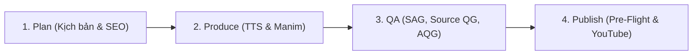

# Quy Chuẩn Nhà Máy Nội Dung (Content Factory Discipline)

> **HỢP ĐỒNG & HARNESS HIỆN HÀNH:**
> 1. Toàn bộ quy trình tuân thủ **Episode Contract 1.0** và CLI `assets/scripts_video/content_factory_pipeline.py` (tham chiếu `.agents/rules/content_factory_pipeline.md`). Cấm dùng legacy score thay cho audio/visual/golden approval theo SHA-256 hash.
> 2. **FIFO QUEUE & NO PREEMPTION:** Mọi kịch bản mới bắt buộc vào hàng đợi tuần tự; cấm xen ngang tác vụ đang chạy trên GPU/CPU.
> 3. **ZERO-FABRICATION:** Cấm bịa đặt số liệu kiểm thử, kết quả render, hoặc YouTube Video ID. Báo cáo bắt buộc có bằng chứng hash thực thi thực tế.
> 4. **VISUAL REGISTRY PREFLIGHT:** Chạy `factory_runner.py registry-preflight --order order.json`. File `assets/visual_library/registry.json` phải được refresh trước khi sản xuất.

---

## 1. Chu Trình 4 Giai Đoạn Chuẩn Hóa

### Bước 1: Planned (Lập Kế Hoạch & Kịch Bản)
- **Định dạng:** `16:9 Landscape 2K QHD (2560x1440)` hoặc `9:16 Portrait 2K QHD (1440x2560) #Shorts`.
- **Sub-3-minute chunking:** Cấm kịch bản nguyên khối. Mỗi tập chia thành các cảnh $\le 180$s (tối ưu 60s–95s) theo 3 Hồi: Khởi nguyên $\le 180$s, Toán học $\le 100$s, Thực nghiệm & Triết lý $\le 240$s.
- **Cấu trúc kịch bản:** Gồm `Đoạn X:`, `Lời thoại:`, `Cảm xúc:`, `[Pexels keywords:]`, `END_TITLE:`, `Music prompt:`.
- **Dry-run SEO:** `python3 skills/media/youtube-publisher/scripts/yt_publish.py upload --video /tmp/dummy.mp4 --md path/to/script.md --dry-run`

### Bước 2: Produce (Sản Xuất Tuần Tự)
- **Hàng đợi:** Quản lý qua `assets/scripts_video/produced_catalog.json` và pipeline runner.
- **Docker Manim:** Render độc lập từng Scene $\le 180$s trong Docker (`manim_media/`), tận dụng cache để sửa/render cục bộ (fail-fast).
- **TTS V0 Gold Standard (Mặc định: Local VieNeu-TTS v3 Turbo trên CUDA):** Tiêu chuẩn **TTS V0 (Direct Raw Script Synthesis)** đọc trực tiếp 100% kịch bản gốc của tác giả / cue sheet mà không qua bộ tiền xử lý ngữ âm, từ điển prosody hay ma trận Wave nào. Kết hợp Chuỗi Master Giọng Đọc 5 Giai Đoạn (Studio Vocal Mastering Chain: Highpass 80Hz, De-mud EQ 300Hz, Presence EQ 3.8kHz, Air Treble 9kHz, EBU R128 Loudnorm -14.5 LUFS) là bộ tổng hợp mặc định cho kênh **ZENPHAM** và **BIẾT ĐỊA LÝ TỪ BA TÔI** (OmniVoice F5-TTS là dự phòng thứ cấp). Tham chiếu `.agents/rules/vietnamese_gold_tts_rules.md`.
- **Audio Mastering:** House target YouTube: Integrated Loudness **-14 LUFS, True Peak $\le -1.5$ dBTP**.
- **Phụ đề:** Faster-Whisper GPU word alignment (chỉ nhận timestamp `recognized` hoặc `manual`, cấm nội suy).

### Bước 3: QA (Chất Lượng Kỹ Thuật & Khán Giả)

Thứ tự pipeline kiểm định: `Script → SAG → Produce → Source QG (4 Tầng) → AQG → Telegram Review → Publish`

1. **Script Audience Gate (SAG) — Thẩm định kịch bản:**
   - Lệnh: `python3 assets/scripts_video/script_audience_gate.py --script path/to/script.md --profile path/to/series_profile.json`
   - Đánh giá 5 trục: Readability (câu $\le 35$ từ), Jargon ($\le 8\%$, bridge trong 300 ký tự), Hook & Retention (50 từ đầu), Tag Hygiene (0 tag nội bộ), TTS Readiness (câu $\le 200$ ký tự, cấm acronym/LaTeX thô). Phải đạt **0 lỗi CRITICAL**.
2. **Source Quality Gate (4 Tầng Kỹ Thuật):**
   - Lệnh: `python3 assets/scripts_video/run_all_quality_gates.py --episode XX` (hoặc pipeline stage runner).
   - **Tier 1 (Technical & Motion):** Freezedetect $\le 4.0$s trên raw render, Blackdetect $\ge 1.5$s, 0% fake motion (cấm crop/sin/cos zoompan FFmpeg).
   - **Tier 2 (Layout & Typography):** Safe Padding (Top $\le 2.95$, Bottom $\ge -2.50$, $|X| \le 5.69$), Zero collision, font tiếng Việt (`Roboto`, `Inter`, `Be Vietnam Pro`), đầu mũi tên nhỏ gọn (`tip_length <= 0.16`, `stroke_width = 2.2 - 2.8`).
   - **Tier 3 (Pedagogy & Math):** Đồ họa toán học áp đảo $\ge 75\%$ (Axes, NumberPlane, Vector, Matrix...). Cấm slide-deck, cấm hộp chữ rỗng, cấm sơ đồ ASCII text.
   - **Tier 4 (Brand & Uniqueness):** 0% lặp footage trong series, Thumbnail Hero $\ge 50\%$, 0% PR thương mại.
3. **Audience Quality Gate (AQG) — Kiểm định master:**
   - Lệnh: `python3 assets/scripts_video/audience_quality_gate.py --video output/master_2k.mp4 --srt output/sub.srt --thumb output/thumb.jpg --profile path/to/series_profile.json`
   - Đánh giá 5 trục: Visual Clarity, Voice Quality (gap $\le 3.5$s, -16 đến -12 LUFS), Cognitive Load (2.5–4.5 syl/s), Attention & Rhythm (freeze $\le 5$s), First Impression. Phải đạt **0 lỗi CRITICAL**.
4. **Series Profile & Scope:**
   - Cấu hình qua `series_profile.json` (target audience, jargon dictionary, thresholds).
   - Thời lượng: Series bắt buộc 15–25 phút; Adhoc linh hoạt. CTA: Series dùng mosaic grid; Adhoc dùng CTA đơn giản.

### Bước 4: Publish & Pre-Flight Gate (Xuất Bản YouTube)
- **Master Clean Feed 100%:** Xuất bản 2K QHD (2560x1440 @ 60fps) qua Lanczos; tuyệt đối không burn-in phụ đề vào video.
- **Phụ đề rời `.srt` cho YouTube CC:** 1–2 dòng, 7–10 từ/dòng ($< 55$ ký tự), cue 1.2s–3.5s ($\le 4.5$s), ngắt tự nhiên, cấm dồn cả đoạn (monolithic dump).
- **7 Cổng Pre-Flight Chặn Cứng (Hard Stop nếu vi phạm):**
  1. `Thumbnail Gate`: File $\le 2$MB, $1920\times 1080$ (16:9) hoặc $1080\times 1920$ (9:16). Hero $\ge 50\%$, punch text 2–4 từ lớn (130–160px).
  2. `Series Footage Gate`: Qua `audit_series_footage.py`, 0% trùng lặp footage trong cùng series.
  3. `Title Gate`: Mobile-first $< 70$ ký tự (tối đa 100 ký tự), chuẩn nhận diện kênh.
  4. `Description Gate`: Đầy đủ 4 phần (Hook, Timestamps từ `00:00`, CTA, Footer & hashtags).
  5. `Tags Gate`: Cấu trúc 3 tầng (Brand, Entity, Long-tail), 400–480 ký tự ($\le 500$ ký tự).
  6. `Category & Lang Gate`: Category 27 (Education) hoặc 22 (People & Blogs), `defaultLanguage: "vi"`.
  7. `Bidirectional Linking Gate`: Short 9:16 trỏ về Longform (`youtu.be/<ID>`); Longform trỏ về Short; CTA Card cuối Short hướng người xem bấm **Related Video** trên YouTube Studio.
- **Quota API:** Khi hết quota hàng ngày, lưu `ready_for_upload` trong `produced_catalog.json` để đồng bộ sau qua `--upload-pending`.

---

## 2. Kỷ Luật Nội Dung, Giọng Điệu & Thị Giác

1. **Zero Pipeline Tag Leakage:**
   - Cấm xuất hiện các tag nội bộ: `V3`–`V7`, `Quality Gate`, `Pre-flight`, `Pipeline`, `Cue`, `Phase`, `Sprint`, `Ticket`, `SHA256`, `Staging`, `Artifact`... trong lời đọc, subtitle, tiêu đề, mô tả, hoặc hình ảnh.
   - Bắt buộc dùng văn nói tự nhiên hướng tới người học và tinh thần làm nghề chuẩn mực.
2. **Đạo Làm Nghề Khiêm Nhường (Zero Corporate Promotion):**
   - Cấm tự PR công ty, chức danh, thương hiệu cá nhân. Giọng kỹ sư thực thi điềm tĩnh, để vẻ đẹp thuật toán và mã nguồn tự khẳng định giá trị.
3. **Quy Chuẩn Footage Pool:**
   - 0% tái sử dụng footage giữa các tập trong cùng series. Manim Dominance $\ge 75\%$ thời lượng. B-roll chỉ dùng làm Hook (5–10s), khoảng thở (5–10s) và Outro.
   - Chỉ dùng 5 nhóm footage chuẩn: (1) Terminal/IDE/CLI logs; (2) Phần cứng bán dẫn/GPU/Datacenter; (3) Toán học/Mạng nơ-ron/Vector field; (4) Kỹ sư Tech-Noir đêm; (5) Không gian chiêm nghiệm (mưa đêm, đèn phố). Cấm footage sách vở hóa/sinh/công sở lệch đề.
4. **Phễu SEO Tech Shorts 9:16 (45s–60s):**
   - Định dạng 1440x2560 @ 60fps, Manim trực quan $\ge 70\%$, nền Obsidian `#0c0d12`.
   - Cấu trúc 3 Hồi: Hồi 1 (0–10s: Paradox Hook) $\rightarrow$ Hồi 2 (10–45s: Core Math Spotlight) $\rightarrow$ Hồi 3 (45–60s: Conversion CTA Card trỏ vào tính năng Related Video).
5. **Quy Chuẩn Outro / Closing CTA (8.00 giây):**
   - Thời lượng chính xác 8.00s (480 frames @ 60fps), audio AAC stereo 48kHz 320kbps. Nền Deep Obsidian (`#080a0f`), lưới mờ (`#1e293b`), cấm coordinate crosshairs thô trắng cắt ngang.
   - Text tiếng Việt render base size 36 rồi scale nhỏ chống lỗi kerning Pango. Cấm emoji Unicode thô (dùng Manim vector mobject).

---

## 3. Quản Trị Đa Kênh & Lưu Trữ Đám Mây (rclone Google Drive)

### Quản Trị Nhận Diện Đa Kênh
- **TÔI ĐỌC SÁCH:** Triết học kinh điển, sách cổ điển. 16:9 Landscape, giọng trầm tĩnh (`speed: 0.94x`).
- **ZENPHAM:** Tiểu luận xã hội, tâm lý đám đông, AI & kỹ nghệ hệ thống. 16:9 Video Essay (`speed: 1.15x`) và 9:16 Shorts (`speed: 1.18x`). Phong cách Neo-Noir.
- **BIẾT ĐỊA LÝ TỪ BA TÔI (`@phamtrai-dialy`):** Phim tài liệu Địa lý Nhân văn. **Quy tắc tối thượng: FOOTAGE-CENTRIC 100%** (cảnh quay thực địa 2K chân thực; Infographics/bản đồ là kính HUD Frosted Glassmorphism $\ge 50\%$ bán trong suốt bổ trợ; 100% clip kèm `.meta.json` khớp kịch bản $\ge 95\%$; giọng đọc TTS V0 Gold đọc trực tiếp từ kịch bản). Tham chiếu `.agents/rules/geographic_documentary_rules.md`.

### Lưu Trữ & Đồng Bộ Đám Mây Qua rclone (Google Drive)
- **Remote:** `phamvuthang@gmail.com:` | **Canonical Root:** `phamvuthang@gmail.com:Content Factory`
- **FUSE Mount (ThinkPad P15):** `/home/zen/GoogleDrive/phamvuthang@gmail.com/Content Factory`
- **Quy tắc truy vấn:** Khi thiếu asset tại `assets/`, bắt buộc kiểm tra FUSE mount hoặc `rclone lsf "phamvuthang@gmail.com:Content Factory/..."`.
- **Cấu trúc taxonomy:** `00_Inbox` (thô) $\rightarrow$ `01_Projects` (Active/Done) $\rightarrow$ `02_Media` (Images/Graphics/Faces) $\rightarrow$ `03_Scripts_Manim` (Drafts/Render/Assets) $\rightarrow$ `04_Sound` (Music/SFX/Voice) $\rightarrow$ `05_Footage` (Raw/Proxy/Selects) $\rightarrow$ `06_Exports` (Review/Final/Sub) $\rightarrow$ `07_Archive`.
- **Đồng bộ tự động:** Dùng `python3 assets/scripts_video/filestore_sync_cli.py` để đồng bộ và giải phóng SSD an toàn.

---

## 4. Kỷ Luật Phòng Chống Thoái Lui Kỹ Thuật (Regression Invariants)

1. **Zero-Rè & Khoảng Nghỉ Kỹ Thuật (2.0s–3.0s, chuẩn 2.4s):**
   - Giọng đọc lọc thông cao Butterworth 80Hz, khử ồn sàn -60dB, nén đa băng tầng.
   - Chèn khoảng nghỉ 2.0s–3.0s (chuẩn 2.4s) tại zero-crossing giữa các luận điểm lớn. Cấm cắt/nối audio ngang đỉnh sóng.
   - House target YouTube: Integrated Loudness $-14.0 \pm 0.5$ LUFS, True Peak $\le -1.5$ dBTP.
2. **Vòng Đời Bố Cục Manim & Toạ Độ (Layout Lifecycle):**
   - Khi dùng layout container (`SplitScreenLayout`, `ComparisonLayout`...), mọi mobject phụ thuộc toạ độ trục `axes.c2p(...)` bắt buộc khởi tạo **SAU KHI** layout container đã thực thi, hoặc add vào `left_hero` trước.
   - Cấm gán toạ độ trên group rỗng (`VGroup().move_to(...)`).
3. **Phân Định Rõ Văn Bản Thường vs Công Thức Toán (Text vs MathTex):**
   - Nhãn text thông thường (`Typography.caption/body/h1`, `MetricBadge.value`) dùng Manim `Text` (Pango/Cairo), cấm truyền LaTeX thô chứa `{t-1}`, `\frac{...}`.
   - Chỉ truyền LaTeX vào `Typography.formula` hoặc `MathTex`.
4. **Neo Tiêu Đề Đỉnh Màn Hình (Header Absolute Anchoring):**
   - Mọi Scene tự do không bọc trong layout container bắt buộc gọi tường minh `.move_to([0, 3.30, 0])` cho `Typography.h1`, tránh tiêu đề rơi vào tâm màn hình $(0,0,0)$.
5. **Dynamic CV Keyframe Sampling:**
   - Module kiểm toán thị giác `visual_harness.py` phải tự động tính cửa sổ Brand Opener theo thời lượng thực của Scene 1 (`scene_01_dur` đến `scene_01_dur + 8.5s`), cấm dùng số giây cố định gây false positive.
