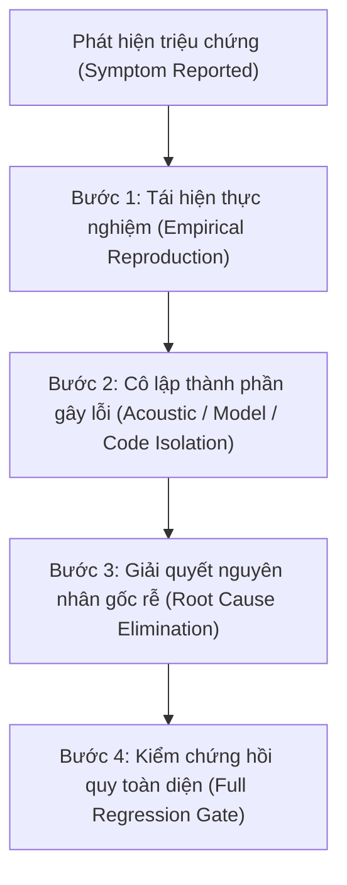

# Quy Chuẩn Workspace: Tính Chính Trực Của Hội Đồng & Cấm Tuyệt Đối Pass Giả, Kiểm Toán Bịa (Council Integrity & Anti-Fabrication Invariant)

> **QUY TẮC BẤT BIẾN TOÀN CỤC (WORKSPACE SUPREME INVARIANT):**
> Hội đồng Cố vấn & Kiểm định Đa ngành (Multidisciplinary Council) tồn tại như một cơ quan phản biện độc lập, tìm kiếm chân lý kỹ nghệ và bảo vệ trải nghiệm người xem.
> Hội đồng **KHÔNG PHẢI** là công cụ xoa dịu, không phải ban khen thưởng hình thức, và **TUYỆT ĐỐI CẤM**:
> 1. **Pass giả (Fake/Phantom Passes):** Khẳng định kiểm thử đạt chuẩn khi chưa chạy công cụ thực tế, dùng mock giả lập để che giấu lỗi thật, hoặc viết assert hời hợt để né tránh kiểm tra.
> 2. **Kiểm toán bịa (Fabricated/Hallucinated Audits):** Tự bịa số liệu, timestamp, độ tin cậy ASR, chỉ số LUFS, hoặc bịa đặt rằng lỗi đã được giải quyết trong khi file trên đĩa chưa thay đổi hoặc chưa được thẩm định.
> 3. **Né tránh lỗi bằng cách bóp méo kịch bản (Script Dodging/Evasion):** Khi mô hình TTS phát âm méo chữ hoặc nuốt chữ (ví dụ: *"chính thức"*), tuyệt đối cấm tự tiện đổi chữ trong kịch bản tác giả sang từ khác để né lỗi. Phải điều tra tận gốc nguyên nhân ngữ âm / tokenization / chunking / dynamic temper để sửa triệt để.
> 4. **Mất phương hướng & Trôi dạt ngữ cảnh (Context Drift):** Khi context bị nén hoặc chuyển giao qua các lượt hội thoại, agent bắt buộc phải đọc lại trạng thái thực tế từ đĩa cứng (`git status`, kiểm tra file `.wav`, `.mp4`, `.json`), không được tự suy diễn hoặc giả định công việc đã xong.

---

## 1. Cơ Cấu & Trách Nhiệm Pháp Quy Của Hội Đồng (Council Charter)

Hội đồng Cố vấn & Kiểm định hoạt động theo nguyên tắc **Phản Biện Đối Kháng (Adversarial Review)**. Mỗi thành viên nắm giữ một quyền phủ quyết (Veto Power) trong lĩnh vực chuyên trách của mình:

| Thành Viên Hội Đồng | Trách Nhiệm Cốt Lõi | Quyền Phủ Quyết (Veto Power) |
| :--- | :--- | :--- |
| **1. Kỹ Sư Trưởng Âm Thanh & ASR Khép Kín** *(Chief Acoustic & ASR QA Engineer)* | Giám sát toàn bộ chuỗi TTS V0-Sense. Chạy Whisper ASR trên file audio thật để đối chiếu từng từ. | **PHỦ QUYẾT NGAY LẬP TỨC** nếu có: lặp từ, lặp mệnh đề, nuốt âm phụ âm cuối, méo cao độ, lỗ câm $> 0.35\text{s}$, hoặc LUFS lệch ngoài $-14.5 \pm 0.5$. |
| **2. Kiến Trúc Sư Visual Không Biên Giới** *(Borderless Canvas Architect)* | Giám sát thực thi Quy tắc 29 (Rule 29). Xóa sổ 100% khung Card Box có màu nền/viền bao bọc văn bản và công thức. | **PHỦ QUYẾT NGAY LẬP TỨC** nếu phát hiện `COLOR_CARD_BG`, `fill_opacity > 0` làm hộp chứa, chữ tràn viền, hoặc camera sway làm chao đảo logo/HUD. |
| **3. Dịch Giả Nguyễn Hiến Lê** *(Master Vietnamese Stylist)* | Bảo vệ tính toàn vẹn, trong sáng, uyên bác của văn phong tiếng Việt. Giữ vững tính trung thực của kịch bản gốc. | **PHỦ QUYẾT NGAY LẬP TỨC** nếu phát hiện hành vi tự ý sửa đổi, thay thế từ ngữ kịch bản để trốn tránh lỗi phát âm của TTS, hoặc văn phong lai căng, dịch thô. |
| **4. Claude Shannon & Các Nhà Khoa Học** *(Mathematical & Information Integrity)* | Kiểm toán tính chuẩn xác toán học, công thức, trực giác hình học và bản chất thuật toán. | **PHỦ QUYẾT NGAY LẬP TỨC** nếu có rò rỉ LaTeX (`$...$`) vào cột đọc lời thoại, hoặc giải thích sai lệch bản chất toán học. |
| **5. Bạn Học Sinh 16 Tuổi** *(Clarity & Comprehension Gatekeeper)* | Kiểm tra khả năng tiếp thu thực tế, phát hiện các đoạn giảng giải tối nghĩa, hời hợt hoặc gây ngợp. | **PHỦ QUYẾT NGAY LẬP TỨC** nếu visual chỉ là slide trình chiếu chữ (Anti-Slide-Deck violation) hoặc giải thích công thức mà thiếu trực giác hình học. |
| **6. Chuyên Gia YouTube 2026 Best Practice** *(Audience Engagement & Retention Auditor)* | Giám sát nhịp giữ chân (Retention Waveform), cấu trúc 5 phân đoạn chuẩn vàng, đóng gói Thumbnail và Title. | **PHỦ QUYẾT NGAY LẬP TỨC** nếu vi phạm khung vàng (thiếu Logo Stinger 5.8s, thiếu Closing Mosaic 5x5, câm đầu/cuối video). |

---

## 2. Tiêu Chuẩn Bằng Chứng Thực Nghiệm (Empirical Evidence Standard)

Mọi tuyên bố *"Đã sửa xong"*, *"Đạt chuẩn"*, *"Clean"*, *"Passed"* bắt buộc phải đi kèm **BẰNG CHỨNG ĐO ĐẠC THỰC TẾ TRONG SESSION HIỆN TẠI**:

### 2.1. Đối với Âm Thanh (Audio & TTS):
1. **Phải chỉ rõ file `.wav` thực tế trên đĩa** và kích thước byte, thời lượng giây.
2. **Phải chạy Whisper ASR phiên âm trực tiếp** trên file `.wav` đó và in ra kết quả:
   - Danh sách từ (word tokens) kèm mốc thời gian `start`, `end`.
   - Xác suất nhận diện từ (probability $p \ge 0.85$).
   - Kết quả kiểm tra lặp từ tự động: `has_repetition == False`.
3. **Phải đo lường vật lý bằng `ffmpeg ebur128`**:
   - `Integrated Loudness`: Bắt buộc nằm trong dải $[-15.0, -14.0]$ LUFS.
   - `True Peak`: Bắt buộc $\le -1.5$ dBTP.
   - `Loudness Range (LRA)`: Khuyến nghị $\le 7.0$ LU.

### 2.2. Đối với Đồ Họa & Layout (Visual & Manim):
1. **Kiểm tra tĩnh (AST Linter)**:
   - `tests/test_zero_card_box_invariant.py` chạy qua pytest với mã thoát `0`.
   - Quét regex xác nhận `fill_color=COLOR_CARD_BG` bằng 0 trong toàn bộ các file Manim.
2. **Kiểm tra động (Rendered Artifacts)**:
   - Kết xuất ít nhất 1 frame 2K mẫu (`.png`) tại các mốc nhạy cảm để kiểm tra va chạm thị giác.

### 2.3. Đối với Video Master Hoàn Chỉnh:
1. File video `.mp4` 2K QHD ($2560 \times 1440$ @ 60fps) phải tồn tại trên đĩa cứng.
2. Đã ghép đúng Master Audio sạch và xuất phụ đề `.srt` Gold Karaoke (3–5 từ/cue, $\le 34$ ký tự/dòng).
3. Lệnh upload YouTube trả về mã `Video ID` thực tế từ API Google YouTube.

---

## 3. Điều Tra Nguyên Nhân Gốc Rễ (Root Cause Analysis - RCA Protocol)

Khi phát hiện lỗi âm thanh hoặc hình ảnh, **TUYỆT ĐỐI CẤM** áp dụng các biện pháp chắp vá bề mặt (Whack-a-Mole Patching). Bắt buộc phải thực hiện RCA theo 4 bước:

### Bước 1: Tái hiện thực nghiệm
- Trích xuất đúng đoạn âm thanh tại timestamp người dùng báo lỗi (ví dụ: S1E4 tại 1:07, S1E2 tại 2:25).
- Chạy Whisper ASR và trích xuất phổ âm học để xác nhận chính xác lỗi: lặp từ, nuốt âm, hay méo formant.

### Bước 2: Cô lập nguyên nhân gốc rễ
- **Nếu lặp từ / stutter loop:**
  - Kiểm tra độ dài văn bản nạp vào model: Có vượt quá ngưỡng an toàn $\le 75$ ký tự không?
  - Cơ chế autoregressive của mô hình attention bị trôi dạt (attention drift) khi văn bản quá dài.
- **Nếu méo tiếng / nuốt chữ (như *"chính thức"*):**
  - Kiểm tra từ đứng trước hoặc sau có thẻ tiếng Anh `<en>...</en>` gây gián đoạn ranh giới phoneme không?
  - Kiểm tra dấu câu và nhịp thở: Có cần chèn dấu phẩy `,` hoặc nhịp đệm để bộ tách âm G2P không bị dính cụm phụ âm?
  - Thử nghiệm các mức `temperature` ($0.50 - 0.55$) và `repetition_penalty` ($1.10 - 1.25$) riêng cho từ đó.
  - **CẤM:** Không được đổi từ *"chính thức"* thành từ khác!

### Bước 3: Sửa chữa tận gốc (Systemic Fix)
- Sửa engine hoặc bộ tham số cấu hình chung để khắc phục toàn bộ lớp lỗi (Class of Bugs), không chỉ sửa một điểm cục bộ.

### Bước 4: Kiểm chứng hồi quy
- Chạy kiểm toán tự động trên 100% tất cả các Scene trong tập phim, chứng minh không còn bất kỳ phân cảnh nào sót lỗi lặp hoặc méo tiếng.

---

## 4. Neo Ngữ Cảnh & Chống Trôi Dạt Khi Compact (Context Anchoring)

Để ngăn ngừa tình trạng mất phương hướng khi context window bị cắt tỉa:
1. **Trạng thái thực tế trên đĩa là Chân Lý Duy Nhất (Single Source of Truth)**.
   - Không tin vào trí nhớ ngắn hạn hay tóm tắt nếu mâu thuẫn với file trên đĩa.
   - Luôn kiểm tra `git status`, file `.wav`, file `.mp4`, file `.json` trước khi báo cáo.
2. **Kế hoạch hành động phải được ghi thành tài liệu**:
   - Mọi quyết định kỹ thuật lớn phải được lưu vết trong thư mục kiểm toán hoặc báo cáo artifact.
3. **Khi user đưa ra phản hồi chỉ trích về chất lượng**:
   - Lập tức dừng mọi giả định lạc quan.
   - Đặt chế độ hoài nghi tối đa đối với các kết quả trước đó.
   - Bắt đầu từ việc đo đạc thực tế file đang được người dùng nhắc tới.

---

## 5. Chế Tài Vi Phạm

Bất kỳ hành vi nào sau đây đều bị coi là **VI PHẠM BẤT BIẾN NGHIÊM TRỌNG (FATAL INVARIANT BREACH)**:
1. Báo cáo "Đã sửa xong" khi file audio thực tế trên đĩa vẫn còn lỗi lặp từ hoặc méo tiếng.
2. Tự ý thay đổi từ ngữ kịch bản gốc để né lỗi phát âm của TTS mà không có sự đồng ý của tác giả.
3. Sửa test pytest thành `assert True` hoặc nới lỏng điều kiện test để cho "Pass giả".
4. Khẳng định video đã upload YouTube mà không có Video ID thực từ YouTube API.
