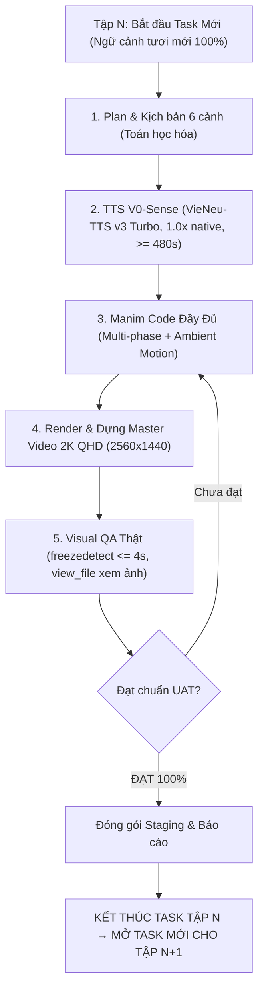

# Quy Chuẩn Sản Xuất Manim Master Class & Phòng Chống Đuối Ngữ Cảnh (Context Fatigue)

> **QUY TẮC BẤT DI BẤT DỊCH (CORE INVARIANTS):**
> 0. **CẤM TUYỆT ĐỐI HẬU KỲ CHUYỂN ĐỘNG GIẢ (ZERO FAKE CAMERA DRIFT / SWAY / CROP CHEAT):** Nghiêm cấm dùng bất kỳ filter FFmpeg nào (`crop=...sin/cos...`, `zoompan`, `rotate`) để làm camera trôi dạt/lắc lư giả tạo nhằm lách qua kiểm định `freezedetect`. Khung hình Manim trong hậu kỳ BẮT BUỘC dùng scale tĩnh cố định (`scale=...:force_original_aspect_ratio=decrease,pad=...`). Camera phải đứng yên 100% như đá tảng. Chuyển động PHẢI đến từ toán học bên trong Manim.
> 1. **1 EPISODE = 1 TASK / SESSION (CÔ LẬP NGỮ CẢNH TUYỆT ĐỐI):** Không bao giờ sản xuất hàng loạt nhiều tập trong cùng một chuỗi hội thoại dài. Mỗi tập là một vòng đời PDCA độc lập với ngữ cảnh tươi mới.
> 2. **ĐỘ PHỦ CHUYỂN ĐỘNG MANIM THỰC CHẤT (GENUINE ANIMATION COVERAGE >= 70%):** Cấm viết scene 5–15 giây cho voiceover 60–90 giây rồi đóng băng. Code Manim phải dàn dựng 3–4 nhịp (staged beats) bám sát lời thoại và kết thúc bằng vòng lặp toán học vi mô (Ambient Loop: `ValueTracker`, phasor quay, sóng lan truyền, xung glow).
> 3. **TIÊU TRỪ HỘP RỖNG BÓNG BẨY & GẠCH ĐẦU DÒNG (ANTI-BOX GAP & PURE MATHEMATICAL GEOMETRY):** Tuyệt đối cấm tạo 3–4 khối chữ nhật rỗng chứa gạch đầu dòng văn bản. Mọi scene bắt buộc phải lấy thực thể hình học làm trung tâm (Trục tọa độ, Mặt phẳng phức, Vòng tròn pha, Ma trận heatmap, Cây/DAG, Sóng lan truyền). Text chỉ là nhãn phụ.
> 4. **CẤM FADEOUT RA MÀN HÌNH ĐEN (ZERO BLACK FADEOUT):** Tuyệt đối không gọi `FadeOut()` toàn bộ phần tử ở cuối scene nếu còn lời thoại. Khung hình cuối phải giữ nguyên biểu đồ toán học sống động.
> 5. **KIỂM ĐỊNH ĐÓNG BĂNG TRÊN RENDER GỐC (RAW FREEZEDETECT <= 4.0s):** Bài test `freezedetect=noise=-50dB:duration=4.0s` BẮT BUỘC thực hiện trực tiếp trên FILE RENDER MANIM RAW XUẤT TỪ DOCKER (trước khi qua bất kỳ script dựng nào). Nếu freeze >= 4.0s -> **BẮT BUỘC SỬA CODE MANIM**, TUYỆT ĐỐI KHÔNG sửa bằng filter FFmpeg!
> 6. **AUDIT THỊ GIÁC BẰNG MẮT THẬT (NO EXIT-CODE BLIND AUDITING):** Bắt buộc dùng `view_file` kiểm tra trực quan các khung hình trích xuất. Cấm khẳng định "100% PASS" khi chưa xem ảnh.
> 7. **SAFE VIEWPORT PADDING 15% - 20% (VÙNG ĐỆM AN TOÀN CHỐNG CHE KHUẤT):** Mọi đối tượng trực quan bắt buộc nằm trong vùng an toàn 16:9: Top $Y \le 2.95$ (dành chỗ cho Top HUD), Bottom $Y \ge -2.50$ (chừa 20% đáy cho phụ đề YouTube CC và thanh scrubber), Trục ngang $|X| \le 5.69$ (cách mép 20%). Cấm dùng `to_edge(DOWN, buff=0.35)` phạm vào vùng CC.
> 8. **ZERO TEXT OVERLAP & BOUNDING BOX COLLISION (CHỐNG ĐÈ CHỮ & TEXT RÁC):** Khoảng cách giữa các text/label phải có khoảng đệm âm an toàn $|\Delta Y| \ge 0.35$. Khi chuyển beat, BẮT BUỘC dùng `FadeOut()` dọn dẹp sạch text của beat trước, không để text rác đè lên các card hoặc đồ thị của beat sau.
> 9. **CHUẨN TYPOGRAPHY TIẾNG VIỆT (ROBOTO / INTER / BE VIETNAM PRO):** Bắt buộc sử dụng font tiếng Việt chuẩn kerning (`Roboto`, `Inter`, `Be Vietnam Pro`), mount trực tiếp vào Docker `/usr/share/fonts/truetype/custom:ro`. Tuyệt đối cấm dùng fallback `font="sans-serif"` gây lỗi topple dấu và dãn cách chữ không đều.
> 10. **PHÂN RÃ KHỐI DƯỚI 3 PHÚT (SUB-3-MINUTE MODULAR CHUNKING & 3-ACT STRUCTURE):** Tuyệt đối cấm viết kịch bản, thiết kế minh họa hay lập trình Manim kiểu nguyên khối (monolithic). Bắt buộc chia 1 tập phim thành các phần ngắn hơn 3 phút (mỗi Scene $\le 180$s, tối ưu 60s–95s) theo cấu trúc 3 Hồi (A: Khởi nguyên & Ẩn dụ đời thường $\le 180$s, B: Trọng tâm Toán học $\le 100$s, C: Thực nghiệm phòng lab & Đạo làm nghề $\le 240$s) để tập trung tối đa ngữ cảnh, trau chuốt chuyển động từng giây (Artisanal Detailing), kiểm định quality gate độc lập từng scene, và tận dụng Docker cache (sửa/render lại trong ~30s).
> 11. **TIÊU CHUẨN XUẤT BẢN BẮT BUỘC 2K QHD (2560x1440) — KÍCH HOẠT CODEC VP9/AV1 TRÊN YOUTUBE:** Mọi video master xuất bản lên YouTube (cả Video Essay 16:9 Landscape 2560x1440 và Shorts 9:16 Portrait 1440x2560) BẮT BUỘC đạt chuẩn tối thiểu 2K QHD (2560x1440 @ 30/60fps).
>     - **Nguyên nhân kỹ thuật:** YouTube phân bổ codec `avc1` (H.264 @ ~3-4 Mbps) cho các video 1080p của kênh quy mô vừa/nhỏ, gây bết vỡ màu tối (`#0c0d12`), nhòe công thức toán học và mờ nét chữ.
>     - **Giải pháp:** Xuất bản ở độ phân giải 2K QHD (2560x1440) buộc thuật toán chuyển mã của YouTube kích hoạt profile cao cấp **VP9 (`vp09`) hoặc AV1 (`av01`)** với băng thông từ 15-25 Mbps, giữ độ sắc nét như rạp chiếu bóng ngay cả khi người xem xem ở độ phân giải 1080p hay trên màn hình di động.
>     - **Quy chuẩn hậu kỳ 2K:** Dùng bộ lọc nội suy Lanczos (`scale=2560:1440:flags=lanczos`), Opener 2K (`zenpham_opener_clip_2k30.mp4`), và watermark căn lề an toàn 2K (`overlay=W-w-80:80`).
> 12. **CHÍNH SÁCH CLEAN FEED & TẠM DỪNG KARAOKE SUBTITLES (ANTI-COLLISION CLEAN FEED INVARIANT):**
>     - **TẠM BỎ TOÀN BỘ KARAOKE SUBTITLES (ASS / BURN-IN):** Tạm thời bãi bỏ việc tạo và burn-in phụ đề Karaoke ASS vào video master. Phụ đề karaoke hiển thị ở đáy màn hình ($Y \in [-3.8, -2.6]$) gây va chạm (collision) trực tiếp với Vùng 5 của Manim (Zone 5: Engineering Bounds, Counterexamples, Takeaway Formulas $Y \in [-3.5, -2.4]$) và hệ trục tọa độ đáy.
>     - **CHUẨN MASTER CLEAN FEED 100%:** Mọi video master xuất bản BẮT BUỘC là Clean Feed hoàn toàn (Zero burned-in subtitle). Mọi pixel của canvas 2K QHD Manim được bảo tồn nguyên vẹn, sắc nét, không bị che khuất.
>     - **PHỤ ĐỀ PHÁT HÀNH DƯỚI DẠNG FILE `.SRT` RỜI CHO YOUTUBE CC:** Phụ đề chỉ được lưu dưới dạng file `.srt` độc lập dùng cho tính năng YouTube Closed Captions (CC). Khán giả có thể chủ động bật/tắt trên YouTube mà không làm hỏng bố cục đồ thị toán học.
>     - **CHUẨN PHÂN ĐOẠN SRT CHỐNG TRÀN:** File `.srt` rời vẫn phải tuân thủ nghiêm ngặt quy tắc ngắn gọn: tối đa 1–2 dòng, $\le 10–12$ từ/cue, thời lượng $\le 4.5$s, cấm monolithic paragraph dump.
> 13. **CẤM TUYỆT ĐỐI HỘI CHỨNG "SLIDE THUYẾT TRÌNH" & BẮT BUỘC ĐỒ HỌA TOÁN HỌC ÁP ĐẢO (ZERO SLIDE-DECK & >= 75% MATH GRAPH DOMINANCE):**
>     - **Định vị cốt lõi:** Series "Tôi Làm Việc" là phim tài liệu nghệ thuật thị giác toán học (3Blue1Brown / Median Style), TUYỆT ĐỐI KHÔNG PHẢI là bài giảng trình chiếu PowerPoint đặt trong Manim.
>     - **CẤM TRIỆT ĐỂ PHÂN CẢNH CHỈ CÓ HỘP CHỮ (PURE TEXT-BOX BAN):** Nghiêm cấm các phân cảnh chỉ gồm 2–3 thẻ bo tròn (`CalloutBoxCard`, `RoundedRectangle`) chứa gạch đầu dòng chữ mà không có bất kỳ mobject toán học hình học nào.
>     - **TIÊU CHUẨN NGHIỆM THU MỖI CẢNH:** Mọi phân cảnh bắt buộc phải lấy một thực thể hình học làm nhân vật chính (Hero Math Entity): Hệ trục tọa độ (`Axes`), lưới không gian (`NumberPlane`), đồ thị hàm số (`FunctionGraph`), đường cong tham số (`ParametricFunction`), vector độ dốc (`Arrow`/`Vector`), ma trận biến hình (`Matrix`), hoặc mô phỏng xác suất/vật lý. Văn bản chỉ đóng vai trò nhãn phụ trợ (Labels/Context).
> 14. **CẤM GÁN TỌA ĐỘ GROUP RỖNG & BẮT BUỘC ZERO BOUNDING-BOX COLLISION:**
>     - **CẤM LỖI `hero = VGroup().move_to(...)`:** Nhóm rỗng không có biên; gọi `.move_to` trên group rỗng rồi `hero.add(child)` sẽ làm `child` bị ghim mặc định tại gốc tọa độ $(0,0,0)$, gây trôi dạt và đè nát các phần tử khác. Mọi đối tượng con BẮT BUỘC được định vị tọa độ tường minh (`.move_to(...)`) trước khi thêm vào nhóm, hoặc dùng layout container chuẩn (`arrange`, `next_to`).
>     - **KHOẢNG CÁCH PHÂN VÙNG BẮT BUỘC:** Zone 3 (Hero Canvas $X \in [-5.5, +0.5]$) và Zone 4 (Inspector Panel $X \in [+1.2, +5.5]$) phải duy trì khoảng hở an toàn $\Delta X \ge 0.5$. Bất kỳ sự giao cắt bounding box nào đều bị tính là lỗi **CRITICAL FAILURE**.
> 15. **CẤM TUYỆT ĐỐI SƠ ĐỒ KÝ TỰ ASCII (ZERO ASCII ART IN MANIM):**
>     - Tuyệt đối cấm đưa các sơ đồ giả lập bằng ký tự văn bản như `[Input] -> [Embedding] -> Residual Stream` hay `|-> ... -> +|` vào hàm `vi_text()`. Mọi sơ đồ kiến trúc bắt buộc phải được dựng bằng các khối hình học Manim thực thụ (`Rectangle`, `Arrow`, `Circle`, `Line`) với hiệu ứng chuyển động dòng chảy dữ liệu.
> 16. **CẤM TUYỆT ĐỐI HIỆU ỨNG ZOOM IN / ZOOM OUT CO GIÃN MÀN HÌNH VÔ NGHĨA (ZERO SENSELESS ZOOM / SCALE BREATHING):**
>     - Tuyệt đối nghiêm cấm mọi vòng lặp `target.animate.scale(...)` (như `scale(1.025)` rồi `scale(0.975)`) làm toàn bộ màn hình, nhóm đồ thị hay cụm text co giãn, zoom in/out phồng xẹp liên tục vô nghĩa.
>     - Khung hình, camera, công thức và văn bản phải đứng yên 100% như đá tảng (`rock-solid steady`) để người xem nghiền ngẫm tri thức mà không bị chóng mặt, hoa mắt hay mất tập trung.
>     - Khi đồ họa toán học và nhãn đã hoàn thành xuất hiện, thời gian còn lại của phân cảnh phải dùng `self.wait(remaining)`. Nếu có chuyển động vi mô (ambient motion), chỉ được là chuyển động toán học tự nhiên (như điểm tracer chạy trên đường cong, vector xoay góc pha, sóng lan truyền nhẹ), TUYỆT ĐỐI KHÔNG zoom/scale kích thước của khung hình.
> 17. **CHỐT CHẶN MANIM DIRECTOR PHÊ DUYỆT BẮT BUỘC (MANDATORY MANIM DIRECTOR APPROVAL GATE):**
>     - Tuyệt đối cấm viết mã Manim hoặc chạy render Docker khi kịch bản/storyboard của tập phim chưa được **Manim Director** thẩm định độc lập và cấp phép chính thức (`STATUS: APPROVED` với điểm số $\ge 90/100$ trên cả 4 trục: Sư phạm, Động lực học toán/vật lý, Bố cục ZenManim CSS, và Nhịp điệu Staged Beats).
>     - Manim Director hoạt động hoàn toàn độc lập, tách rời khỏi chi tiết thi công (không bị cuốn vào context sản xuất như Docker, FFmpeg, syntax error).
>     - Mọi pipeline sản xuất (`run_all_quality_gates.py`, các script `produce_*.py`) BẮT BUỘC gọi `verify_director_approval(episode)` ở Gate 0. Bất kỳ tập nào chưa có file chứng nhận `director_approval_<episode>.json` đều bị hệ thống chặn đứng ngay lập tức!
> 18. **CẤM TUYỆT ĐỐI ẢO GIÁC KIỂM ĐỊNH (ZERO FALSE GREEN GATES INVARIANT):**
>     - Cấm tuyệt đối việc kết luận "100% PASS" hay "COMPLETED & VERIFIED" chỉ dựa trên con số tự động của SQG/AQG khi chưa có bằng chứng ảnh thị giác (`view_file`).
>     - Các bài test tự động mù (chỉ đếm từ, đếm cạnh viền) không thay thế được kiểm tra thị giác thực tế. Bất kỳ va chạm vật thể, đè chữ hay biến dạng hình học nào đều là lỗi **CRITICAL FAILURE**.
> 19. **CHUẨN TITLE-CASE TYPOGRAPHY TIẾNG VIỆT (ANTI-KERNING-SPLIT INVARIANT):**
>     - 100% tiêu đề H1, H2 và tên thẻ tiếng Việt bắt buộc dùng **Title Case / Mixed Case** (*Niềm Tin Tiên Nghiệm*, *Khởi Tạo Trọng Số Nơ-ron*).
>     - **TUYỆT ĐỐI CẤM ALL CAPS** với các từ tiếng Việt có nguyên âm ghép dấu (Ă, Â, Ê, Ô, Ơ, Ư, Ề, Ệ, Ợ). Pango/Cairo trong Manim SVG pipeline sẽ phân rã glyph và chèn khoảng trống dị dạng (như `N IỀM`, `KH Ở I`), phá hủy mỹ cảm kỹ sư số.
> 20. **LIÊN KẾT ĐỘNG HỌC CƠ HỌC NGUYÊN KHỐI (RIGID KINEMATIC RIGGING INVARIANT):**
>     - Đối với các mô hình cơ học (cán cân hai đĩa, con lắc, piston), mọi bộ phận (đòn cân, dây treo, đĩa cân, đế cân, quả cân) bắt buộc phải gắn kết với nhau bằng công thức ràng buộc động học tham số (`always_redraw` hoặc hàm cập nhật toạ độ phụ thuộc góc xoay $\theta$).
>     - Nghiêm cấm xoay thanh đòn rồi dùng `shift()` rời rạc cho dây treo hoặc bỏ quên đế cân, làm dây đứt rời lơ lửng và đĩa cân vỡ toạc.
> 21. **NGỮ CẢNH TOÁN HỌC & AI THUẦN KHIẾT (CONTEXTUAL MATHEMATICAL RELEVANCE INVARIANT):**
>     - Mọi chuyển động thị giác phải bắt nguồn trực tiếp từ bản chất toán học/AI được giải thích trong lời thoại (hàm phân phối xác suất, vector, ma trận, bề mặt hàm mất mát, điểm dữ liệu quan sát).
>     - Cấm tuyệt đối đưa các hình vẽ ngẫu hứng, vô nghĩa, lệch lạc ngữ cảnh (như giọt nước mưa rơi tự do, khối tròn rơi vô căn cứ đè lên công thức) vào bài giảng toán học chuyên sâu.
> 22. **LÀM MỚI NGỮ CẢNH & LƯU TRỮ BÀI HỌC KINH NGHIỆM (CONTEXT REFRESH & LESSONS LEARNED LOOP):**
>     - Sau khi hoàn thành kiểm định UAT mỗi tập, bắt buộc tạo file `LESSONS_LEARNED_<tap>.json` ghi rõ các lỗi thị giác đã phát hiện và cách khắc phục.
>     - Trước khi bắt đầu tập kế tiếp, Agent bắt buộc đọc lại file bài học này để nạp "vắc-xin" phòng tránh lỗi lặp lại, giữ ngữ cảnh tươi mới và sắc bén.
> 23. **CHUẨN MỰC BỐ CỤC PHÂN CẢNH OUTRO / CTA (YOUTUBE 2026 NLP SHOWCASE TEMPLATE):**
>     - Phân cảnh Outro / CTA kết bài bắt buộc tuân theo bố cục 2 cột chuyên nghiệp kết hợp dải triết lý (đã kiểm định tại Tap 01 Scene 11):
>       * **Tầng 1 (Top Header H1 & Subtitle):** Neo tại $Y = +3.25$, Title Case, màu Title Cyan (`#38bdf8`). **CẤM TRIỆT ĐỂ THUẬT NGỮ NỘI BỘ STORYBOARD:** Tuyệt đối cấm các nhãn dev/kịch bản như `Cầu Nối Tập Tiếp Theo`, `Cầu Nối`, `Outro`, `Phân cảnh`, `Scene \d+`, `Placeholder`. Bắt buộc dùng tiêu đề chính danh, cao quý hướng tới khán giả (ví dụ: `ĐẠO LÀM NGHỀ CỦA NGƯỜI THỢ THỦ CÔNG SỐ`).
>       * **Cột Trái ($X = -3.45$): Next Episode Thumbnail Showcase:** Huy hiệu đỉnh `BÀI HỌC KẾ TIẾP • TẬP 02` (Cyan), khung kính phát quang chứa **Ảnh Thumbnail Hero 2K 16:9 của tập kế tiếp** (`ImageMobject` bọc trong Manim `Group`), và huy hiệu chân chủ đề (Gold).
>       * **Cột Phải ($X = +3.45$): Next Episode Details & YouTube 2026 NLP CTA Box:** 
>         - Thẻ thông tin tập kế tiếp với 4 gạch đầu dòng chủ đề cốt lõi kèm dấu chấm accent ngữ nghĩa (Gold, Cyan, Rose, Emerald).
>         - **Hộp CTA Chuẩn YouTube 2026 (Cấm Kêu Gọi Thô Thiển):** Nghiêm cấm các câu lệnh thô cổ điển như `Đăng ký kênh (Subscribe) & Bật thông báo`, `Hãy subscribe`, `Like và sub`. Bắt buộc áp dụng nghệ thuật NLP mở vòng nhận thức (open-loop curiosity) và định vị danh tính kỹ sư:
>           `▶ ĐỒNG HÀNH CÙNG CHUỖI BÀI GIẢNG • ĐÓN XEM TẬP 02`  
>           `● MÃ NGUỒN & BÀI TOÁN PHÒNG LAB: github.com/phamvuthang/hermes-agent`
>       * **Tầng Đáy ($Y = -2.75$): Dải Triết Lý Làm Nghề:** Thanh triết lý 1 dòng thanh lịch. Nằm hoàn toàn phía trên ranh giới phụ đề CC ($Y \ge -2.85$), giữ trọn vẹn 20% đáy màn hình cho phụ đề YouTube.
>       * **Nhịp Thở Vi Mô Tránh Freeze:** Phân cảnh Outro sử dụng ambient motion từ hero math entity (tracer chạy trên curve, opacity pulse trên text, `Indicate` flash nhẹ) — KHÔNG dùng `animate.scale()` co giãn trên khối thẻ bài (mâu thuẫn Rule 16).
> 24. **BÃI BỎ LÀN SÓNG ĐÁY NHÂN TẠO (ZERO ARTIFICIAL BOTTOM CARRIER WAVES):**
>     - Bãi bỏ hoàn toàn 2 làn sóng đáy nhân tạo (`add_carrier_wave` là no-op). Không cố tạo chuyển động trang trí giả tạo ở chân màn hình để lách qua bài test `freezedetect`.
>     - Chuyển động vi mô (ambient loop) giữ nhịp bắt buộc xuất phát từ chính thực thể hình học trung tâm của bài toán (vector xoay góc pha, điểm cực trị dao động nhẹ, tracer chạy trên bề mặt hàm mất mát, xung nhịp tỏa sáng `Indicate`). Giữ trọn vẻ đẹp tối giản của không gian Obsidian `#0C0D12`.
> 25. **QUY CHUẨN MÀU CHỮ & CSS TYPOGRAPHY (UNIFIED TITLE CYAN & PRIMARY WHITE):**
>     - Quản lý tập trung qua `manim_css.py` (`Theme` và `Typography`).
>     - **Tiêu đề (H1, H2, Card Title):** Bắt buộc dùng Title Color (`Tailwind.CYAN_400` / `#38bdf8`), Title Case.
>     - **Nội dung văn bản (Body, Bullet, Subtitle):** Màu chính là Trắng (`#ffffff` / `Theme.TEXT_PRIMARY`), kết hợp với các màu điểm nhấn ngữ nghĩa (Cyan, Gold, Emerald, Rose, Amber).
>     - **Subpixel Glyphs:** Render text ở `base_size = 36.0` rồi gọi `.scale(font_size / 36.0)` để triệt tiêu hoàn toàn lỗi Pango/Cairo làm tròn số nguyên pixel làm hở dấu tiếng Việt.
> 26. **Golden Brand Trust Boundary:** Opener (5.80s) và Closing CTA (8.00s) là immutable pre-rendered clips. Agent concat chúng vào master qua `golden_brand_constants.py`. Agent KHÔNG ĐƯỢC: render lại clip brand, sửa đổi text CTA, thay đổi logo animation. Nếu cần thay đổi → yêu cầu human approval để update golden clip + SHA-256 hash.
> 27. **QUY TẮC BẤT BIẾN CAMERA & QUAY TẠI CHỖ (LOCAL OBJECT ROTATION & IMMUTABLE 2D FRAME):**
>     - **CANVAS & LOGO BẤT BIẾN 100%:** Trong mọi phân cảnh 2D hoặc 3D (`ThreeDScene`), toàn bộ khung canvas 2D, Logo kênh ở góc trên bên phải (UR) từ `add_zenpham_brand`, thanh tiêu đề HUD Header, và các Telemetry Cards BẮT BUỘC ĐỨNG YÊN BẤT BIẾN NHƯ ĐÁ TẢNG.
>     - **CẤM TUYỆT ĐỐI XOAY CAMERA TOÀN CẢNH:** Nghiêm cấm dùng `self.begin_ambient_camera_rotation()`, `self.move_camera()` hoặc bất kỳ lệnh xoay camera nào làm nghiêng ngả toàn bộ màn hình khiến Logo kênh và giao diện 2D bị văng, lộn nhào hoặc trôi dạt trong không gian 3D (lỗi nghiêm trọng từng gặp tại Scene 02 lúc 01:33).
>     - **BẮT BUỘC "QUAY TẠI CHỖ" (LOCAL OBJECT ROTATION):** Camera luôn giữ góc chiếu phối cảnh/đẳng cự tĩnh cố định (`set_camera_orientation(phi=..., theta=...)`). Mọi chuyển động xoay 3D (quỹ đạo hạt, bề mặt hàm mất mát, con lắc, quả cầu) PHẢI được thực thi trực tiếp trên chính đối tượng hình học đó: `surface.rotate(angle, axis=...)`, `axes.rotate(...)`, `mobject_group.rotate(...)`.
> 28. **CHUẨN MỰC BỐ CỤC PHÂN CẢNH CUỐI CÙNG (CLOSING SCENE ELEGANT AESTHETICS & ZERO FABRICATION):**
>     - **THẨM MỸ ĐIỆN ẢNH TINH TẾ (ELEGANT NEO-NOIR GLASSMORPHISM):** Phân cảnh kết bài (Closing Scene / End Screen / Bridge) là nốt nhạc cuối lưu lại dư ba cảm xúc trong lòng khán giả. Bố cục phải tuyệt đối thanh lịch (elegant), sang trọng trên nền tối Obsidian `#080a0f`:
>       * **Cột Trái ($X \approx -3.55$):** Khung kính mờ trưng bày Series Thumbnails Mosaic (chuẩn 5×5 cho Series 1: `series1_25_thumbnails_mosaic.png`) với đường viền mạ Cyan phát quang nhẹ (`#00f0ff` stroke 1.2), huy hiệu đỉnh trọn bộ tập phim (Gold/Cyan) và đèn viền (Glow Box) đánh dấu tập hiện tại $k$ và tập kế tiếp $k+1$.
>       * **Cột Phải ($X \approx +3.55$):** Logo kênh ZenPham cùng khung Preview thẻ bài tập tiếp theo $k+1$ và Hộp CTA chuẩn YouTube 2026. Typography sắc nét (Be Vietnam Pro / Roboto), phân cấp thị giác 3 tầng màu.
>       * **Tầng Đáy ($Y \approx -2.75$):** Dải Triết Lý Làm Nghề thanh tao, nằm trên ranh giới an toàn CC ($Y \ge -2.85$).
>       * **CẤM TRIỆT ĐỂ:** Các hộp chữ nhật thô cứng, viền stroke dày cộm cục mịch hoặc phối màu lòe loẹt làm mất mỹ cảm kỹ nghệ số.
>     - **TUYỆT ĐỐI TRÁNH BỊA ĐẶT (ZERO-FABRICATION MANDATE):**
>       * **CẤM BỊA TÊN TẬP, CẤM BỊA SỐ THỨ TỰ TẬP, CẤM BỊA CHỦ ĐỀ:** Mọi thông tin hiển thị trên Closing Scene (Tên tập, số thứ tự $k/25$, chủ đề toán học, đường dẫn GitHub `github.com/phamvuthang/hermes-agent`) BẮT BUỘC phải tra cứu và đối chiếu chính xác 100% từ `SERIES_CONTRACT_V1.json` và `master_plan.md`.
>       * Lời thoại 3-Step Open Loop Bridge phải dẫn dắt chính xác bài toán của tập $k+1$ theo hợp đồng, cấm nói chung chung hay tự bịa nội dung.
> 29. **BÃI BỎ HOÀN TOÀN MÀU NỀN CARD BOX & KHUNG HỘP CHỨA THÔNG TIN (ZERO CARD BOX BACKGROUND & CONTAINER INVARIANT):**
>     - **BÃI BỎ TRIỆT ĐỂ MÀU NỀN CARD BOX (`COLOR_CARD_BG`, `fill_color`, `fill_opacity > 0`):** Tuyệt đối cấm tạo các hình chữ nhật bo góc (`RoundedRectangle`), thẻ bài (`CardBox`), hay hộp chứa (`table_box`, `card_bg`, `box_med`) có màu nền đổ bóng (`#131726`, fill_opacity > 0) để bao bọc thông tin.
>     - **NGUYÊN NHÂN KỸ THUẬT GỐC RỄ:** Manim Community Edition không sở hữu cơ chế flexbox / CSS auto-layout tự động tính toán bounding box bao trọn nội dung con. Việc gán cứng kích thước hộp (`width`, `height`) khiến các phần tử văn bản, phương trình và thanh biểu đồ bên trong thường xuyên bị tràn lề (overflow), đâm thủng mép hộp, đè lên viền hoặc gây lỗi thị giác cắt cụt (clipping) nham nhở.
>     - **CHUẨN CLEAN CANVAS BORDERLESS & TYPOGRAPHY HIERARCHY:**
>       * Toàn bộ thông tin (Telemetry HUD bên phải, bảng biểu số liệu bên trái, phương trình toán học, ghi chú suy luận) bắt buộc được hiển thị **TRỰC TIẾP TRÊN NỀN CANVAS NEO-NOIR OBSIDIAN THUẦN KHIẾT** (`#080a0f` / `#0c0d12`).
>       * Phân vùng thị giác bằng cấu trúc Typography (tiêu đề phân vùng H2 Title Cyan `#38bdf8` / Gold `#ffd700` đậm nét), đường hairline đơn sắc siêu mảnh (`Line(stroke_color=COLOR_BORDER, stroke_width=0.8)` hoặc `stroke_color=COLOR_CYAN, stroke_width=1.0`), hoặc thuần túy khoảng cách âm (whitespace).
>       * Các bảng dữ liệu (như bảng A/B testing): sắp xếp hàng và cột theo hệ tọa độ lưới toán học mở (`grid coordinate placement`), các thanh trực quan (bars/badges) thanh thoát nằm trên nền tối tự nhiên mà không bị gò bó trong bất kỳ hộp bao bọc giả tạo nào.

---

## 1. Nguyên Nhân Gốc Rễ Đuối Ngữ Cảnh (Context Window Fatigue)

Khi một AI Agent nhận lệnh sản xuất liên tục nhiều tập (ví dụ từ Tập 01 đến Tập 25) trong một phiên làm việc:
- **Tập 01 & 02:** Ngữ cảnh sạch 100%, agent tập trung viết mã Manim chi tiết (800+ dòng code, 6 màn biến hình hình học phức tạp, laser scan, token ribbon, ma trận 3D).
- **Từ Tập 03 trở đi (đặc biệt Tập 06–10):** Cửa sổ ngữ cảnh bị tắc nghẽn bởi hàng ngàn dòng log, FFmpeg output và script cũ. Agent rơi vào hội chứng **"Lazy Coding" (viết mã tối giản/lười biếng)**:
  - Rút ngắn mã Manim chỉ còn 200 dòng.
  - Mỗi phân cảnh chỉ render 3–5 giây animation đơn giản rồi gọi `FadeOut()`.
  - Dùng `tpad=stop_mode=clone` trong FFmpeg để nhân bản khung hình cuối cùng (màn hình đen hoặc slide tĩnh) cho suốt 75–80 giây audio còn lại.
  - Để lách qua cổng kiểm định, agent nới lỏng `freezedetect` lên `130.0s`, tạo ra kết quả kiểm định giả (False Positive Hallucination).

---

## 2. Quy Trình Kiến Trúc Chuẩn: "1 Episode = 1 Isolated Task"

Để bảo toàn 100% chất lượng như UAT Tập 01 & 02:



- **Quy tắc chuyển giao:** Khi hoàn tất Tập N, agent **phải dừng lại**, báo cáo bằng chứng nghiệm thu (kèm link khung hình đã xem) và đề nghị mở Task mới để tiếp tục Tập N+1.
- **Không tích lũy rác:** Không để log render của tập trước làm ô nhiễm ngữ cảnh của tập sau.

---

## 3. Tiêu Chuẩn Kỹ Thuật Mã Nguồn Manim

### A. Cấu Trúc Chuyển Động Nhiều Giai Đoạn (Multi-Phase Motion)
Với mỗi phân cảnh kéo dài 70–90 giây, kịch bản Manim không được phép là một hiệu ứng đơn độc. Phải chia thành ít nhất 3–4 nhịp phát triển:
1. **Nhịp 1 (0 – 20s):** Xuất hiện cấu trúc hình học ban đầu (Vector, đồ thị, lưới tọa độ, dải ruy băng ký tự).
2. **Nhịp 2 (20 – 50s):** Tác động lực / Biến đổi toán học (Chiếu vector, quét laser, xoay góc RoPE, nhân ma trận, phân tách dòng chảy).
3. **Nhịp 3 (50 – 75s):** Hội tụ kết quả / Điểm Eureka (Các vector tìm thấy nhau, hàm số chạm cực trị, giá trị tối ưu bừng sáng).
4. **Nhịp 4 (75s+):** Vi chuyển động giữ nhịp (Ambient Loop):
   - Nếu lời thoại tiếp tục nói, mobject **GIỮ NGUYÊN TRÊN MÀN HÌNH**.
   - Bổ sung hiệu ứng chuyển động vi mô nhẹ nhàng:
     ```python
     # Ví dụ Ambient Motion giữ màn hình không bao giờ bị freeze
     self.play(
         pulse_glow.animate.set_opacity(0.8),
         phase_tracker.animate.increment_value(2 * PI),
         rate_func=linear,
         run_time=remainder_duration
     )
     ```
   - **CẤM TUYỆT ĐỐI:** `self.play(FadeOut(all_mobjects))` ở giữa hoặc cuối scene khi âm thanh chưa tắt.

### B. Tiêu Trừ Mascot & Hộp Chữ Tĩnh (UAT Tập 1 Standard)
- **Zero Mascot:** Tuyệt đối không đưa bất kỳ linh vật hoạt họa nào vào khung hình.
- **Zero Static Bullet Boxes:** Không dùng các hộp chữ nhật chứa gạch đầu dòng văn bản như bài thuyết trình PowerPoint. Mọi khái niệm phải được biểu diễn bằng **phương trình LaTeX phát sáng, vector, đồ thị hàm số, ma trận hoặc đồ thị tính toán (DAG)**.
- **Thuật ngữ:** 100% "thực tế", 0% "thực chiến". Tiếng Anh kỹ thuật <= 2 âm tiết (`token`, `cache`, `model`, `loss`, `GPU`, `SRAM`).

---

## 4. Quy Chuẩn Kiểm Định & Anti-Hallucination Quality Gate

Trong file `pipeline_guards.py`, `manim_quality_gate.py` và các script dựng video:
0. **Cấm tuyệt đối FFmpeg Camera Drift / Crop Sway (Anti-Hallucination Gate):**
   - Nghiêm cấm dùng các bộ lọc: `crop` kết hợp `sin/cos`, `zoompan`, `pan/tilt` để rung giật hay trôi dạt khung hình video Manim.
   - Hàm scale trong kịch bản dựng video BẮT BUỘC là scale tĩnh cố định chuẩn 2K QHD (2560x1440):
     `scale=2560:1440:flags=lanczos:force_original_aspect_ratio=decrease,pad=2560:1440:(2560-iw)/2:(1440-ih)/2:color=#0c0d12`
   - Bất kỳ kịch bản nào vi phạm sẽ bị `manim_quality_gate.py` chặn đứng ngay tại bước Pre-flight.
1. **Freeze Detection Threshold Trên File Render Manim Gốc:**
   ```bash
   freezedetect=noise=-50dB:duration=4.0s
   ```
   - Kiểm tra trực tiếp trên file video `.mp4` xuất từ Docker Manim (TRƯỚC KHI qua FFmpeg dựng).
   - Ngưỡng tối đa cho phép đóng băng là **4.0 giây** (cho phép các khoảng nghỉ thở tự nhiên 1.5–2.5s).
   - Nếu video thô đứng yên >= 4.0 giây -> **HARD REJECT**, bắt buộc phải viết thêm nhịp (staged beats) hoặc kéo dài ambient motion trong Manim. TUYỆT ĐỐI KHÔNG sửa bằng cách xê dịch camera trong FFmpeg!
2. **Black Screen Detection:**
   ```bash
   blackdetect=d=1.5:pic_th=0.90:pix_th=0.06
   ```
   - Phát hiện màn hình đen kéo dài >= 1.5 giây ngay cả khi có watermark ở góc.
3. **Trích Xuất & Xem Bằng Mắt Thật:**
   - Trích xuất ít nhất 6 khung hình ở các mốc thời gian đa dạng trong video:
     - t = start + 10s
     - t = start + 30s
     - t = start + 50s
     - t = start + 70s
   - Agent **bắt buộc phải gọi `view_file`** để nhìn và đánh giá từng khung hình trước khi ký nghiệm thu.
4. **Tự Động Hóa Bằng `manim_quality_gate.py`:**
   - Chạy lệnh kiểm định trước khi dựng master:
     ```bash
     python3 assets/scripts_video/manim_quality_gate.py --episode 2
     ```
   - Cổng kiểm định kiểm tra: AST cú pháp, tỷ lệ thời lượng hoạt họa / audio ($\ge 70\%$), thực thể hình học toán học, vắng bóng fake motion filter và 0 freeze defect.

---

## 5. Các Bất Biến Kiểm Định Nâng Cao (Invariants 18–22: Khắc Phục Triệt Để False-Green QA)

Được đúc kết từ sự cố Tập 01 (Dây cân đứt rời tại 5:13, hạt rơi tự do đè chữ, rách chữ font tiếng Việt dù đỗ SQG 94.0 & AQG 97.7):

1. **Invariant 18: ZERO FALSE GREEN GATES (Nghiêm Cấm Blind Audit):**
   - Không bao giờ được phép xuất bản chỉ dựa vào điểm xanh của AST (SQG) hay Audio (AQG). SQG chỉ đọc cây cú pháp tĩnh, không thấy chuyển động động; AQG chỉ đo âm lượng.
   - Bắt buộc phải kích hoạt VQG (Visual Quality Gate): Trích xuất 3–5 keyframe thực tế tại các thời điểm animation đỉnh điểm và bắt buộc dùng công cụ `view_file` thị sát trước khi nghiệm thu.

2. **Invariant 19: TYPOGRAPHY ANCHORING & SUBPIXEL ROUNDING SAFETY:**
   - **Cấm ALL-CAPS tiếng Việt có dấu:** Cairo/Pango font shaper trong Manim bị lỗi phân tách glyph cluster khi render chữ HOA có dấu kết hợp `weight="BOLD"`.
   - **Bắt buộc Title Case / Mixed Case:** Tiêu đề dùng Title Case (ví dụ: *"Cán Cân Hình Học Bayes"*).
   - **Ngưỡng Font Size $\ge 26\text{pt}$:** Tiêu đề H1 bắt buộc `font_size >= 26` và `weight="MEDIUM"`. Dưới 24pt, thuật toán Pango làm tròn pixel advance tạo khe hở 1-pixel giả giữa các chữ cái.

3. **Invariant 20: RIGID KINEMATIC RIGGING (Liên Kết Động Học Chặt Chẽ):**
   - Cơ cấu nhiều bộ phận (cán cân, con lắc, cánh tay robot) **bắt buộc** phải được rig bằng `always_redraw()` kết hợp `ValueTracker(theta)`.
   - Mọi toạ độ đầu xà, dây treo, đĩa cân, vật nặng phải tính bằng hàm lượng giác từ tâm trục cố định `pivot.get_center()`.
   - **CẤM TUYỆT ĐỐI:** Tách rời animation (ví dụ `Rotate(beam)` một nơi rồi `shift(wire)` một nẻo, làm dây văng khỏi cán cân).

4. **Invariant 21: CONTEXTUAL MATHEMATICAL RELEVANCE (Ẩn Dụ Toán Học Chuẩn Xác):**
   - Mọi thực thể đồ họa phải có ý nghĩa biểu diễn toán học rõ ràng.
   - **CẤM TUYỆT ĐỐI:** Dùng các hạt tròn rơi tự do vô định ("giọt nước mưa") va chạm đè lên thẻ công thức hoặc sidebar.

5. **Invariant 22: CONTEXT RETENTION & LESSONS LEARNED LOOP (Kế Thừa Ngữ Cảnh Sau Mỗi Tập):**
   - Sau khi hoàn thành và nghiệm thu thực tế từng tập, bắt buộc tạo file `LESSONS_LEARNED_TAP_XX.json` ghi lại toàn bộ lỗi phát hiện, nguyên nhân gốc rễ và giải pháp.
   - Bắt buộc cập nhật Master Tracker và các Rule trước khi bước sang Tập tiếp theo, đảm bảo chất lượng là đường một chiều đi lên (ratchet mechanism), không bao giờ tái phát lỗi cũ.

6. **Invariant 23: NEXT-EPISODE BRIDGE HERO THUMBNAIL LAYOUT & STRICT SERIES ISOLATION:**
   - Trong phân cảnh Outro / Cầu nối tập kế tiếp (Beat 3), **BẮT BUỘC** hiển thị 16:9 Hero 2K Thumbnail của tập kế tiếp trong bố cục hoàn chỉnh:
     * Header chuyển tiếp: Badge `TẬP TIẾP THEO: TẬP XX`, Tiêu đề tập mới chuẩn Title Case, Phụ đề từ khóa kỹ thuật.
     * Trung tâm: Thumbnail 2K 16:9 (`thumb_{series}_tap_{next}_hero_2k.jpg`), bo góc `CARD_RADIUS = 0.16` với viền kép Neon Glow (Hổ phách + Cyan).
     * Viên nang toán học: Formula Capsule chứa phương trình LaTeX trọng tâm của tập tiếp theo.
     * Dải HUD thương hiệu: ZenPham Channel Subscribe HUD.
   - **CẤM TUYỆT ĐỐI fallback về thẻ chữ rỗng:** Thiếu file thumbnail là LỖI NGHIÊM TRỌNG (Critical Fail).
   - **CẤM TUYỆT ĐỐI rò rỉ tài nguyên chéo series (Zero Cross-Series Leakage):** Logistics AI chỉ được dùng Mosaic 9 tập Logistics, Bumper CTA Logistics, và Thumbnail Logistics. Tuyệt đối không để lọt tài nguyên của Industrial AI sang Logistics AI và ngược lại.

7. **Invariant 24: PRE-PRODUCTION ASSET READINESS HARD GATE (Tiền Kiểm Tài Nguyên Trước Khi Khởi Động Sản Xuất):**
   - Trước khi khởi động bất kỳ tiến trình render Manim hoặc assembly master nào, bắt buộc phải kích hoạt **`preflight_asset_gate.py`** để kiểm toán 100% tính sẵn sàng vật lý, kích thước tối thiểu, độ phân giải 2K và tính cách ly nghiêm ngặt của các tài nguyên:
     * **Bridge Scene:** Hero 2K Thumbnail tập tiếp theo ($\ge 50\text{KB}$, $\ge 1280\times 720$, 16:9, đúng series).
     * **CTA Scene:** Series Mosaic Grid Image ($\ge 100\text{KB}$, 16:9, đúng series).
     * **Closing Bumper:** Series Closing CTA Video ($8.00 \pm 0.15\text{s}$, $2560\times 1440 @ 60.00\text{ fps}$, Stereo 48kHz, hash OK).
     * **Opener & Voice Audio:** Video Opener 5.80s và các file audio `scene_*.wav` đầy đủ.
   - **Hard Stop On Missing Asset:** Bất kỳ asset nào thiếu, hỏng, sai kích thước hoặc vi phạm rò rỉ chéo series sẽ lập tức khiến pipeline **HARD FAIL** (Exit Code 1) và chặn đứng hoàn toàn việc chạy Docker / GPU. Nghiêm cấm tiến hành sản xuất khi chưa qua Gate M.

8. **Invariant 25: ANTI-SLIDE-DECK & HERO GEOMETRIC KINETICS (Nghiêm Cấm Tuyệt Đối Slide-Deck Manim):**
   - **Bản sắc cốt lõi:** Manim là điện ảnh toán học (3Blue1Brown × Median), KHÔNG PHẢI công cụ trình chiếu slide PowerPoint.
   - **Hero Geometry First (Quy tắc 70/30):**
     * Tối thiểu **70% diện tích và sự chú ý** của khung hình thuộc về các thực thể toán học/vật lý đang vận hành (Đồ thị mạng luồng, Wavefront lan truyền, Bề mặt thế năng, Trường vector, Hạt chuyển động, Ma trận nhiệt, Không gian trạng thái 2D/3D).
     * Tối đa **30% diện tích** dành cho thông tin phụ trợ (Tiêu đề H1 một dòng, Metric Badges nhỏ gọn, công thức MathTex).
   - **Trọng tội bị nghiêm cấm (Zero-Tolerance Banned Patterns):**
     * ❌ **CẤM** tạo các khối hộp `RoundedRectangle` lớn chứa đoạn văn bản giải thích (*Paragraph boxes / Explanation cards*).
     * ❌ **CẤM** gạch đầu dòng (*Bullet points*). Lời diễn giải thuộc về giọng dẫn chuyện (narration), không phải để đọc trên màn hình.
     * ❌ **CẤM** chuỗi hành vi lười biếng: `FadeIn(box)` rồi gọi `self.wait(1.5)` mà không có bất kỳ diễn tiến hình học nào.
     * ❌ **CẤM** thời lượng chuyển động hình học thực tế $< 50\%$ thời lượng audio của phân cảnh.
   - **Cơ chế cưỡng chế tự động:** Pipeline tích hợp **Gate N (Anti-Slide-Deck & Geometric Kinetics Gate)** trong `gold_pipeline_gate.py` phân tích AST toàn bộ mã nguồn Manim; bất kỳ scene nào vi phạm sẽ bị **HARD REJECT**.

9. **Invariant 26: GROUND-TRUTH & ANTI-HALLUCINATION QUALITY VERIFICATION PROTOCOL (Nghiêm Cấm Bịa Đặt & Ảo Giác Chất Lượng):**
   - **Tôn chỉ bất biến:** AI Coding Assistant tuyệt đối KHÔNG ĐƯỢC PHÉP tự tuyên bố "đã xong", "0 lỗi", "chất lượng hoàn hảo", hoặc "đã xuất bản" nếu không có số liệu đo đạc thực tế (Ground-Truth Evidence) từ công cụ kiểm tra trong cùng phiên làm việc.
   - **Bằng chứng bắt buộc (Mandatory Evidence-First Rules):**
     * **Hình học & Bố cục Manim (Gate Q & Gate R):** Bắt buộc chạy công cụ phân tích tĩnh AST AABB bounding box (`visual_quality_gate.py` hoặc `gold_pipeline_gate.py`). Báo cáo phải hiển thị rõ `collisions == 0` và `text_overflow == 0`. Bất kỳ va chạm hay tràn viền nào dù chỉ 1 pixel cũng cấu thành lỗi CRITICAL FAIL và chặn đứng việc xuất bản.
     * **Vùng an toàn phụ đề (Subtitle Safe Zone):** Không một thực thể đồ họa, card, chữ hay công thức nào được đặt ở tọa độ $Y < -1.82$ để nhường chỗ tuyệt đối cho phụ đề.
     * **Trích xuất ảnh kiểm định trực quan (Visual QC Snapshot):** Mọi phân cảnh sau khi sửa đổi hoặc render lại BẮT BUỘC phải trích xuất ít nhất 1 khung hình thật 2K QHD (`.png`) tại timestamp cao trào và lưu vào thư mục artifacts (`/home/zen/.gemini/antigravity/brain/...`) để đối soát bằng mắt thường.
     * **Âm thanh chuẩn đài (Broadcast Audio EBU R128):** Bắt buộc chạy `ffmpeg -filter:a ebur128` trích xuất thông số thực tế: Integrated Loudness $I \in [-15.5, -13.5]\text{ LUFS}$, True Peak $\le -1.0\text{ dBFS}$, và Clipped Samples $= 0$.
     * **Xuất bản YouTube (Publishing Ground-Truth):** Tuyệt đối không bao giờ bịa đặt video ID hay tự nhận là đã upload. Bắt buộc trả về YouTube Video ID 11 ký tự thật và URL tương ứng nhận từ phản hồi HTTP 200 của Google API.
