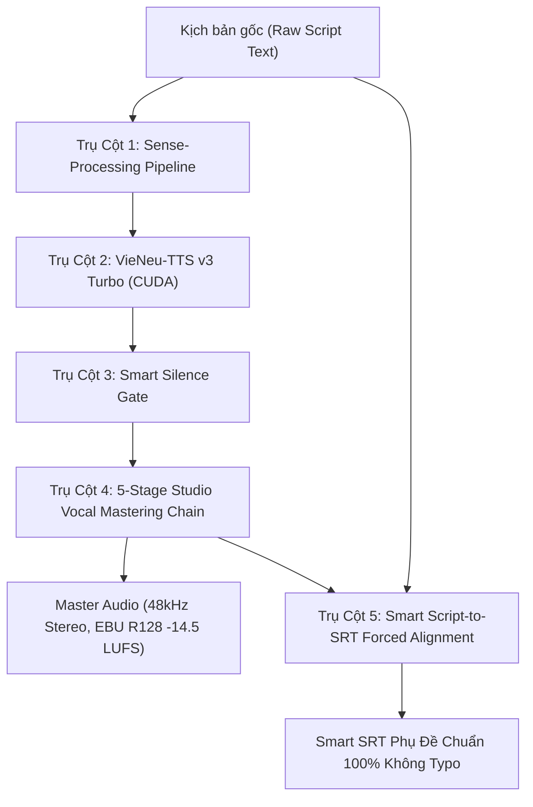

# Quy Chuẩn Workspace: TTS V0-Sense (Sense-Processing, Direct Raw Synthesis & Smart Silence Gate) — Tiêu Chuẩn Gold TTS Duy Nhất

> **QUY TẮC BẤT BIẾN WORKSPACE (WORKSPACE INVARIANT):**
> Kể từ phiên bản hiện tại, phương thức **TTS V0-Sense** chính thức được xác lập là **TIÊU CHUẨN GOLD TTS DUY NHẤT** áp dụng cho **100% MỌI KÊNH VÀ MỌI VIDEO** trong toàn bộ workspace `hermes-agent` (ZENPHAM, Biết Địa Lý Từ Ba Tôi, Tôi Đọc Sách, Reality Decode, YouTube Shorts, Long-form Video Essay, Podcast, Documentary).
> 
> **BÃI BỎ HOÀN TOÀN TTS V8:**
> - Tuyệt đối **KHÔNG** sử dụng bộ tiền xử lý ngữ âm V8 (`vietnamese_expressive_prosody.py`, `prosody_dictionary.json`).
> - **KHÔNG** gán ma trận 24 Wave ngữ điệu nhân tạo.
> - **KHÔNG** băm nhỏ câu văn, không chèn ngắt nghỉ nhân tạo, không khóa từ ghép thủ công làm biến dạng nhịp đọc tự nhiên của tiếng Việt.
> - **CẤM TUYỆT ĐỐI LÀM CHẬM (ZERO-ATEMPO-SLOWDOWN):** Nghiêm cấm dùng bộ lọc `atempo < 1.0` (như 0.73x, 0.85x, 0.94x) hoặc chèn khoảng câm zero cơ học. Giọng đọc phải chạy đúng 100% tốc độ tự nhiên 1.0x của VieNeu-TTS v3 Turbo. Thời lượng Shorts 50s được bù đắp bằng nhạc nền ambient và visual conversion CTA, tuyệt đối không kéo dãn giọng đọc.
> - **BẢN CHẤT V0-SENSE:** Giữ nguyên 100% cốt lõi đọc trực tiếp kịch bản tự nhiên (Direct Raw Synthesis), kết hợp tầng **Sense-Processing** có kiểm soát, triệt tiêu khoảng lặng ngắt quãng bằng **Smart Silence Gate**, và hậu kỳ qua **5-Stage Studio Vocal Mastering Chain**.

---

## 1. Kiến Trúc 4 Trụ Cột Kỹ Thuật Cốt Lõi



### 1.1. Trụ Cột 1: Sense-Processing Pipeline (Tiền Xử Lý Ngữ Cảm & Chuẩn Hóa)
1. **Chuẩn hóa thuật ngữ tiếng Anh chuyên ngành (`<en>...</en>`)**:
   - VieNeu v3 Turbo hỗ trợ thẻ native `<en>...</en>` để kích hoạt bộ G2P tiếng Anh chuẩn quốc tế.
   - Mọi từ vựng công nghệ, tên riêng (ví dụ: `<en>Innoria</en>`, `<en>Solution</en>`, `<en>Overfitting</en>`, `<en>DAG</en>`, `<en>Softmax</en>`, `<en>Transformer</en>`, `<en>Loss</en>`) đều được tự động bọc thẻ `<en>`, bảo toàn 100% âm đuôi (như âm "-a" của Innoria) và xóa sổ lỗi đọc lai tiếng Việt thô kệch.
2. **Khai thác thẻ cảm xúc thực tế (`[cười]`)**:
   - Theo phân tích mã nguồn VieNeu (`phonemize_text.py`), mô hình chỉ hỗ trợ 3 thẻ cảm xúc non-verbal. Trong đó:
     - Thẻ `[cười]` / `[chuckle]` (`<|emotion_1|>`) sinh âm bật cười nhẹ *"hà / hơ"* rất tự nhiên và rõ ràng $\rightarrow$ **Được phép sử dụng tại các điểm châm biếm, nghịch lý kỹ thuật**.
     - Thẻ `[thở dài]` và `[hắng giọng]` sinh âm quá nhỏ ($\sim 0.2\text{s}$ rumble), bị nuốt âm trong ngữ cảnh câu $\rightarrow$ **Cấm lạm dụng**.
   - Mọi thẻ tự bịa khác (như `[buồn]`, `[vui]`, `[ngạc nhiên]`) đều bị xóa hoặc chuyển hóa thành dấu câu để tránh việc VieNeu đọc thành tiếng chữ trong ngoặc.
3. **Dấu ngắt nhịp kịch tính (Dramatic Script Punctuation)**:
   - Sử dụng dấu ba chấm `...`, dấu gạch ngang dài `—`, dấu hai chấm `:` để tạo khoảng dừng kịch tính tự nhiên $0.25\text{s} - 0.35\text{s}$ có chủ đích.
4. **Dynamic Scene Temper**:
   - **Scene 01 (Hook / Mở đầu kịch tính)**: `temper = 0.58 - 0.60` (giọng biến thiên sống động, lôi cuốn).
   - **Scene Toán học / Phân tích code / Luận điểm kỹ thuật**: `temper = 0.52 - 0.54` (đĩnh đạc, chắc chắn, tập trung).
   - **Scene Outro / Đúc kết triết lý**: `temper = 0.52` (trầm tĩnh, lắng đọng).

---

### 1.2. Trụ Cột 2: Direct Raw Synthesis Trên VieNeu v3 Turbo CUDA & Chuẩn Nhịp Đọc Tự Nhiên 1.0x (Zero-Atempo-Slowdown)
- **Engine:** VieNeu-TTS v3 Turbo chạy cục bộ trên GPU NVIDIA Quadro RTX 5000 (16GB VRAM, CUDA).
- **Môi trường Python:** `/home/zen/hermes-agent/vieneu_tts_test/.venv/bin/python`.
- **Mã nguồn thực thi:** `/home/zen/hermes-agent/assets/scripts_video/tts_v0_sense_synthesizer.py`.
- **Giọng đọc mẫu (Default Voice Clone):**
  - Kênh **ZENPHAM** & **BIẾT ĐỊA LÝ TỪ BA TÔI**: `assets/voices/Zen Mien Tay/zenpham-zen-meditation-mientay.wav`.
- **Bất biến Tốc độ Tự Nhiên 1.0x (Native 1.0x Neural Cadence & Zero-Atempo-Slowdown)**:
  - Giọng đọc chạy ở 100% tốc độ tự nhiên của mô hình VieNeu. **CẤM TUYỆT ĐỐI áp dụng bộ lọc `atempo < 1.0`** (như `atempo=0.73` hay `atempo=0.94`) hoặc chèn mảng số 0 khoảng câm (`np.zeros(...)`) làm nhịp đọc lê thê, rời rạc, méo cao độ.
  - Chuẩn nhịp đọc tự nhiên là sự điềm đạm toát ra từ chính câu chữ khúc chiết của kịch bản và nhịp thở của mô hình, không phải bằng cách kéo dãn thời gian âm học.
  - **Tách rời thời lượng Shorts 50.0s**: Lời thoại đọc tự nhiên 1.0x (thường kéo dài 36s–42s cho 110–130 từ). CẤM kéo dãn giọng đọc sang 48.8s; khoảng trống còn lại đến 50.0s dành cho nhạc nền ambient pad và visual conversion CTA dẫn dắt người xem click Related Video.
- **Quy chuẩn Vi phân đoạn câu văn (Sentence-Level Chunking)**:
  - CẤM nạp nguyên khối văn bản 200–300 từ vào một lần gọi model duy nhất (gây attention drift, nuốt chữ đuôi câu, méo cao độ).
  - Bắt buộc phân tách kịch bản thành từng câu văn độc lập theo dấu chấm câu (`.`, `?`, `!`, `\n\n`) trước khi tổng hợp, sau đó ghép nối mượt mà với khoảng đệm nghỉ tự nhiên (inter-sentence pause $0.25\text{s} - 0.35\text{s}$).

---

### 1.3. Trụ Cột 3: Smart Silence Gate (Diệt Sạch Lỗ Hổng Câm & Bảo Toàn Âm Đuôi)
- **Nguyên nhân vật lý**: Quá trình chia chunk khi tổng hợp trên GPU dễ gặp hiện tượng "missed EOS / early stop delay" khi gặp số liệu hoặc ký tự đặc biệt, khiến mô hình sinh ra $4\text{s} - 7\text{s}$ khoảng lặng chết.
- **Cơ chế hoạt động an toàn (Safe Margin)**:
  - Quét năng lượng RMS từng frame $20\text{ms}$ trên toàn bộ file âm thanh thô.
  - **Ngưỡng năng lượng an toàn:** `threshold_rms = 0.0008` (CẤM dùng ngưỡng quá cao như $0.005$ hay $0.0015$ làm xén lẹm vào các phụ âm đuôi tắc /t, k, c, p/, âm mũi /nh, ng/ và thanh điệu nặng/hỏi của tiếng Việt).
  - **Vùng đệm an toàn (Padding Margin):** Giữ lại ít nhất $40\text{ms}$ trước khi fade-in và sau khi fade-out (`pad_fade = 0.04s`) để bảo vệ 100% nguyên âm và phụ âm.
  - **Ngưỡng nén:** Chỉ nén các khoảng lặng chết bất thường $> 0.60\text{s}$ về mức nghỉ ngắt câu tự nhiên $0.25\text{s} - 0.30\text{s}$. TUYỆT ĐỐI KHÔNG nén các khoảng ngắt nghỉ tự nhiên $0.35\text{s} - 0.50\text{s}$ giữa các vế câu.

---

### 1.4. Trụ Cột 4: 5-Stage Studio Vocal Mastering Chain
Mọi tệp âm thanh sau khi qua Smart Silence Gate bắt buộc phải đi qua chuỗi xử lý hậu kỳ âm học FFmpeg để đạt chuẩn phát thanh truyền hình quốc tế:

```bash
ffmpeg -y -i input_gated.wav \
  -af "highpass=f=80, equalizer=f=300:t=q:w=1.5:g=-2.0, equalizer=f=3800:t=q:w=1.2:g=3.0, treble=g=3.5:f=9000:t=s, loudnorm=I=-14.5:TP=-1.5:LRA=7.0" \
  -ar 48000 -ac 2 output_master.wav
```

1. **Highpass 80Hz:** Triệt tiêu tiếng ù gió rền hạ âm, rumble cơ học và pop mic.
2. **De-mud EQ (300Hz, Q=1.5, -2.0dB):** Gọt bớt độ đục dải trung trầm (boxiness), giúp giọng thanh thoát.
3. **Presence EQ (3.8kHz, Q=1.2, +3.0dB):** Tăng cường độ rõ của phụ âm, độ sắc nét và tách bạch của từng âm tiết tiếng Việt.
4. **Air Treble Shelf (9kHz, +3.5dB):** Mở rộng không gian phòng thu, tạo độ sang trọng, mượt mà ở dải cao.
### 1.5. Trụ Cột 5: Smart Script-to-SRT Forced Alignment (Bảo Đảm Tuyệt Đối Không Typo)
- **Quy tắc bất biến phụ đề**: Phụ đề SRT bắt buộc phải được tạo theo phương thức **Smart Script-to-SRT Forced Alignment** (`assets/scripts_video/smart_script_srt_aligner.py`).
- **Cơ chế**:
  1. Sử dụng **Faster-Whisper trên CUDA** với `word_timestamps=True` để trích xuất mốc thời gian âm học chính xác đến từng mili-giây (`start_ms`, `end_ms`).
  2. Dùng thuật toán so khớp chuỗi (Sequence Matching) để **chiếu 100% từ ngữ trong KỊCH BẢN GỐC CỦA TÁC GIẢ (Canonical Script Text)** lên mốc thời gian của Whisper.
  3. **Cam kết 0% Typo**: Tuyệt đối **KHÔNG** sử dụng trực tiếp text nhận diện thô của Whisper (`s.text`). Toàn bộ tên riêng, thuật ngữ công nghệ (`Innoria`, `Pierre Simon Laplace`, `Thomas Bayes`, `Softmax`, `Shannon Entropy`, `ECE`), dấu câu và chữ hoa đều được bảo toàn 100% theo bản thảo gốc của tác giả.

### 1.6. Trụ Cột 6: Zero-Code/LaTeX Leak Invariant (Tuyệt Đối Cấm Rò Rỉ Code & LaTeX vào Thoại)
- **Quy tắc bất biến phát âm**: Cột kịch bản đọc (Narration Script) và bất kỳ văn bản nào đưa vào bộ tổng hợp TTS V0-Sense **TUYỆT ĐỐI CẤM CHỨA MÃ NGUỒN HOẶC KÝ HIỆU TOÁN HỌC LATEX**.
- **Các lỗi cấm tuyệt đối**:
  1. **Công thức LaTeX**: Ký hiệu đô la `$...$`, `$$...$$`, phân số `\frac{...}{...}`, đạo hàm riêng `\partial`, vector in đậm `\mathbf`, v.v. (Vi phạm sẽ khiến TTS đọc thành chuỗi vô nghĩa: *"đô-la frac pasola..."*).
  2. **Ký hiệu biến số Hy Lạp trần**: Cấm để `\eta`, `\kappa`, `\alpha`, `\beta` trong thoại. Bắt buộc chuyển thành tiếng Việt nói tự nhiên (ví dụ: *"ê-ta"*, *"cáp-pa"*, *"an-pha"* hoặc *"tốc độ học"*, *"số điều kiện"*).
  3. **Định dạng code Markdown**: Dấu backticks (`` `...` ``), ngoặc nhọn `{...}`, chỉ số dưới `_`, chỉ số trên `^`.
- **Ranh giới phân định**: 100% công thức toán học và biểu thức đại số thuộc về **Cột Hero Stage / Telemetry HUD** (màn hình hiển thị cho mắt xem), còn **Cột Lời Thoại (Narration Script)** phải là 100% văn phong tiếng Việt tự nhiên, khúc chiết, giàu hình tượng để tai nghe.
- **Kiểm soát tự động**:
  - `tts_v0_sense_synthesizer.py`: Tự động chuyển đổi các ký tự Hy Lạp quen thuộc sang phát âm tiếng Việt và thanh trừng/cảnh báo mọi công thức LaTeX sót lại.
  - `tests/test_s1_e*_masterclass_blueprint_empirical.py`: Chặn đứng ngay ở cửa kiểm thử qua hàm `test_zero_latex_or_code_leaks_in_narration`.

---


## 2. Tiêu Chuẩn Thực Thi Trong Mã Nguồn

### 2.1. Lệnh Dòng Lệnh (CLI)
```bash
/home/zen/hermes-agent/vieneu_tts_test/.venv/bin/python assets/scripts_video/tts_v0_sense_synthesizer.py \
  --text-file path/to/script.txt \
  --output path/to/scene_master.wav \
  --temper 0.54 \
  --ref-wav "assets/voices/Zen Mien Tay/zenpham-zen-meditation-mientay.wav"
```

### 2.2. Sử Dụng Trong Mã Python
```python
from tts_v0_sense_synthesizer import TtsV0SenseEngine

engine = TtsV0SenseEngine()
# Tự động: Sense-Processing -> VieNeu CUDA -> Smart Silence Gate -> 5-Stage Studio Mastering
engine.synthesize(
    raw_text=raw_script,
    output_wav=output_path,
    temper=0.54,
    scene_index=1
)
```

### 2.3. Cổng Kiểm Soát Chất Lượng Âm Thanh (Audio Quality Gate - AQG)
1. **Zero Silence Gaps**: Tuyệt đối không tồn tại bất kỳ khoảng câm nào $\ge 0.50\text{s}$ trong file âm thanh hoàn thiện.
2. **EBU R128 Compliance**: Integrated Loudness $-14.5 \pm 0.5$ LUFS, True Peak $\le -1.5$ dBTP.
3. **Zero Clutter**: 0% vấp tiếng, 0% nuốt âm đuôi tiếng Anh.
4. **Định dạng âm thanh xuất bản**: **48,000 Hz, 24-bit / 16-bit Stereo PCM WAV**.
