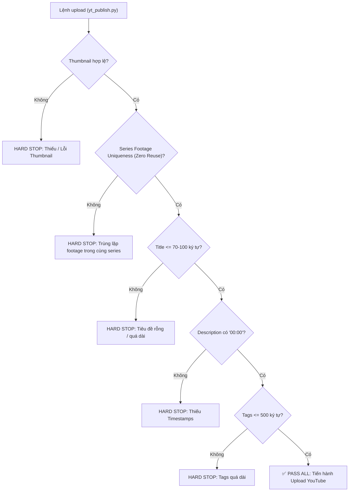

# YouTube Publishing & Packaging Protocol
========================================

> **QUY TẮC BẤT BIẾN (INVARIANT):**
> Trước khi bất kỳ video nào được tải lên YouTube (dù là Video Dài 16:9 hay Shorts 9:16), hệ thống **BẮT BUỘC** phải có đầy đủ:
> 1. **Ảnh Thumbnail / Cover Scene đúng Chuẩn & đúng Template** nhận diện kênh (tỷ lệ chuẩn, độ phân giải cao, file < 2MB, typography nghệ thuật, không ngắt đôi từ).
> 2. **Siêu dữ liệu (Metadata) chuyên nghiệp**: Tiêu đề Mobile-first, Mô tả 4 phần có mốc mục lục từ `00:00`, Thẻ tags 3 tầng từ khóa, và Category/Language chuẩn xác.
> 
> Bất kỳ lệnh xuất bản nào thiếu một trong các yếu tố trên sẽ bị hệ thống **CHẶN NGAY LẬP TỨC (HARD STOP)**.

---

## 1. Tiêu Chuẩn Thumbnail & Cover Scene

Mọi Thumbnail phải được tạo tự động thông qua `assets/scripts_video/cover_design_engine.py` hoặc thiết kế thủ công tuân thủ nghiêm ngặt các quy số kỹ thuật sau:

### 1.1. Thông số kỹ thuật bắt buộc
| Thuộc tính | Video Dài (Landscape 16:9) | Shorts (Portrait 9:16) |
| :--- | :--- | :--- |
| **Độ phân giải** | `1920 x 1080` (tối thiểu `1280 x 720`) | `1080 x 1920` (tối thiểu `720 x 1280`) |
| **Định dạng** | JPEG / JPG / PNG | JPEG / JPG / PNG |
| **Dung lượng tối đa** | `<= 2.0 MB` (Giới hạn API YouTube) | `<= 2.0 MB` |
| **Hệ màu & Tương phản** | sRGB, Độ tương phản cao, có Dark Vignette Gradient | sRGB, Vùng an toàn (Safe Zone) tránh UI che |

### 1.2. Nhận diện thương hiệu theo kênh
* **Kênh ZENPHAM (`🔴 ZENPHAM`)**:
  - **Pill Badge**: Nền đỏ Ruby Crimson `#DC2D2D` (`rgba(220, 45, 45, 0.94)`), text trắng.
  - **Màu chữ chính**: Trắng tinh khiết (`#FFFFFF`), điểm nhấn Neon Red (`#FF4B4B`).
  - **Phong cách thị giác (Hero Image)**: Neo-noir, tương phản mạnh, bóng đổ sâu, ánh sáng điện ảnh, hình ảnh trừu tượng / triết học.
* **Kênh TÔI ĐỌC SÁCH (`📖 TÔI ĐỌC SÁCH`)**:
  - **Pill Badge**: Nền xanh trầm Forest Sage `#46825A` (`rgba(70, 130, 90, 0.92)`), text trắng.
  - **Màu chữ chính**: Màu ngà ấm (`#FFFAF0`), điểm nhấn màu hổ phách Amber (`#E6C382`).
  - **Phong cách thị giác**: Sách cổ, bàn trà, cửa sổ mưa, ánh sáng vàng tĩnh lặng, hoài niệm.
* **Kênh BIẾT ĐỊA LÝ TỪ BA TÔI (`🌏 BIẾT ĐỊA LÝ TỪ BA TÔI`)**:
  - **Pill Badge**: Nền vàng Gold `#E6A822` (`rgba(230, 168, 34, 0.94)`), text xám đen đậm.
  - **Màu chữ chính**: Trắng tinh (`#FFFFFF`), điểm nhấn màu vàng hoàng hôn (`#FFE65A`).
  - **Phong cách thị giác**: Đại cảnh phong cảnh thực địa Việt Nam, sông ngòi, flycam núi non hùng vĩ, ánh sáng ban mai/hoàng hôn.

### 1.3. Quy tắc Typography & Tiêu Đề Trên Thumbnail (Title Rules)
1. **TIÊU ĐỀ TEXT BẮT BUỘC LẤY THEO TIÊU ĐỀ ĐÃ DUYỆT CỦA TẬP**:
   - Tuyệt đối **CẤM lấy tên file slug kỹ thuật** (Ví dụ cấm hiển thị `vietnam_nhung_mien_song_tap_03`, `tap_01`, hay `c_c_n_g_l_ri_ng_t` lên ảnh bìa).
   - Bắt buộc phải sử dụng Tiêu đề Nghệ thuật đã được duyệt chính thức:
     * *Tập 01*: Line 1: `MIỀN TÂY NAM BỘ`, Line 2: `SỐNG CÙNG DÒNG NƯỚC MÊ KÔNG`
     * *Tập 02*: Line 1: `HÀ NỘI`, Line 2: `THÀNH PHỐ CỦA NHỮNG LỚP THỜI GIAN`
     * *Tập 03*: Line 1: `HUẾ`, Line 2: `MỘT KINH ĐÔ ĐẶT VÀO PHONG CẢNH`
2. **Bảo toàn từ ghép tiếng Việt**: Tuyệt đối không ngắt dòng làm gãy từ ghép (Ví dụ: `ngẫu nhiên`, `hiện tại`, `tự do`, `năng suất`, `bình thường`, `thời gian`, `sông nước`, `phong cảnh`,...).
3. **Số dòng tối đa**: 2 dòng cho tiêu đề chính (tối đa 3 dòng nếu có phụ đề nhỏ).
4. **CẤM TUYỆT ĐỐI**:
   - Không lấy frame snapshot thô từ video (lệnh `ffmpeg -ss ... -vframes 1` không chữ, không badge).
   - Không để ảnh bị mờ, vỡ hạt, hoặc text chìm vào nền do thiếu shadow / gradient overlay.
   - **CẤM SAO CHÉP MÙ QUÁNG (ZERO BLIND COPYING):** Tuyệt đối cấm copy các file generic (`thumb_tap_*.jpg`) từ kho lưu trữ chung hoặc từ các series khác (như lấy ảnh của series Địa Lý cho series Tôi Làm Việc). Thumbnail bắt buộc phải được sinh từ script chuyên biệt hoặc thiết kế đúng chủ đề, nội dung và mã nhận diện kênh của chính video đó.
   - **XÁC THỰC NỘI DUNG THỊ GIÁC (VISUAL RELEVANCE AUDIT):** Trước khi upload, bắt buộc đối chiếu mã băm và kiểm tra nội dung hình ảnh đảm bảo 100% khớp với chủ đề bài học.

---

## 2. Tiêu Chuẩn Siêu Dữ Liệu (Metadata SEO)

Mọi video xuất bản phải có đầy đủ 4 trường siêu dữ liệu chuẩn hóa từ `seo_metadata.py`:

### 2.1. Tiêu đề (Title) — Mobile-First
* **Độ dài khuyến nghị**: Dưới 70 ký tự (để không bị cắt cụt dấu `...` trên ứng dụng YouTube di động).
* **Độ dài tối đa cho phép**: 100 ký tự.
* **Cấu trúc**:
  - Dạng hỏi / cảm xúc: `[Câu hỏi trăn trở / Hook mạnh] — [Chủ đề] | [Tên Kênh]`
  - Ví dụ: `Vì Sao Càng Bận Ta Càng Thấy Rỗng? — Lạm Phát Năng Suất | ZENPHAM`
  - Ví dụ: `Hà Nội: Thành Phố Của Những Lớp Thời Gian • Tập 02 | BIẾT ĐỊA LÝ TỪ BA TÔI`
* **Shorts**: Bắt buộc gắn `#Shorts` ở cuối tiêu đề.

### 2.2. Mô tả (Description) — Cấu Trúc 4 Phần Hoàn Chỉnh
1. **Phần 1: Hook & Thông điệp trung tâm (Lead-in)**: 2 - 3 câu mở đầu sâu sắc khơi gợi sự đồng cảm hoặc tò mò triết học.
2. **Phần 2: Mục lục & Mốc thời gian (Timestamps / Chapters)**:
   - **Bắt buộc bắt đầu bằng `00:00`** để YouTube kích hoạt thanh tua chương (video chapters).
   - Mốc thời gian tương ứng với từng phân cảnh thực tế của video.
3. **Phần 3: Lời kêu gọi hành động (CTA)**: Đặt câu hỏi mở để khán giả để lại bình luận dưới video, tăng tương tác thuật toán.
4. **Phần 4: Footer thương hiệu & Bản quyền**: Slogan kênh, thông tin bản quyền và 3 - 5 hashtags chính thức (`#ZENPHAM`, `#TrietHocDoiThuong`, `#BietDiaLyTuBaToi`,...).

### 2.3. Thẻ Từ Khóa (Tags Taxonomy)
* **Quy mô tối ưu**: Khoảng 400 - 480 ký tự (dưới giới hạn cứng 500 ký tự của YouTube).
* **Cấu trúc 3 tầng (3-Tier)**:
  - *Tier 1 (Brand)*: Tên kênh, host, định dạng (`ZENPHAM, Podcast Việt, Video Essay, Zen Baritone`).
  - *Tier 2 (Entity/Topic)*: Thực thể chính, tác phẩm, nhân vật (`Trang Tử, Nam Hoa Kinh, Hà Nội, Hồ Gươm, Gen Y`).
  - *Tier 3 (Long-Tail & Search Intent)*: Cụm từ tìm kiếm dài (`khủng hoảng tuổi 30, sống chậm lại, địa lý việt nam cảm xúc`).

### 2.4. Danh mục & Ngôn ngữ
* **Category ID**:
  - `27` (Education) cho các video học thuật, triết học, địa lý, kiến thức đời sống.
  - `22` (People & Blogs) cho các video tự sự, nhật ký, podcast cá nhân.
* **Default Language**: Bắt buộc là `vi` (Tiếng Việt).

---

## 3. Cổng Kiểm Soát Kỹ Thuật (Pre-Flight Gate)

Trước khi thực hiện `youtube.videos().insert`, script `yt_publish.py` chạy hàm kiểm định `validate_preflight_qa()`:

### Quy định kiểm định Footage cho các video thuộc cùng 1 Series:
* **BẮT BUỘC KHÔNG TRÙNG LẶP FOOTAGE:** Mọi video thuộc cùng một series (như *Tôi Làm Việc*, *Tôi Đọc Sách*, *Biết Địa Lý*) phải sử dụng tập hợp footage (B-roll, background clips) hoàn toàn độc lập giữa các tập, bao gồm cả Video Dài 16:9 và Shorts 9:16.
* **CẤM:** Tuyệt đối không copy mã nguồn trỏ chung vào folder `clips_raw/` của tập trước.
* **AUDIT:** Bắt buộc chạy `python3 assets/scripts_video/audit_series_footage.py --series <SERIES_NAME> --audit` để xác thực 0% trùng lặp trước khi upload.

### Các cờ ghi đè khẩn cấp (Emergency Override Flags)
* `--allow-no-thumbnail`: Cho phép upload video khi chưa có thumbnail (chỉ dùng khi debug nội bộ).
* `--skip-qa-gate`: Bỏ qua toàn bộ kiểm tra QA (chỉ dùng cho tác vụ kiểm thử hệ thống).

---

## 4. Tiêu Chuẩn Xuất Bản Gold Publishing Pipeline & Chống Bịa Đặt (Zero-Fabrication Invariants)

1. **Khóa An Toàn Đường Dẫn Cũ / Nháp (Hard Quarantine Gate):**
   - Nghiêm cấm upload bất kỳ file video nào nằm trong các đường dẫn lưu trữ cũ, nháp hoặc nguyên mẫu (`_archive/`, `manim_production_stack/`, `legacy_`, `poc_`).
   - Lệnh `yt_publish.py` tự động phát hiện và chặn đứng tức thì (`HARD SAFETY GATE TRIGGERED`).
2. **Liên Kết Hai Chiều Bắt Buộc (Mandatory Bidirectional Linking):**
   - **Từ Video Dài sang Shorts:** Mô tả của video dài 16:9 bắt buộc chứa danh sách liên kết trực tiếp tới các video Shorts đã xuất bản (`https://youtube.com/shorts/{short_id}`).
   - **Từ Shorts sang Video Dài:** Mô tả của từng video Short bắt buộc chứa liên kết ngược về video dài (`https://youtube.com/watch?v={long_id}`) và lời kêu gọi chuyển hướng xem trọn vẹn.
3. **Xác Thực Video ID Thực Tế (Ground-Truth YouTube ID Verification):**
   - AI assistant tuyệt đối không được tự bịa video ID (chuỗi 11 ký tự ngẫu nhiên) hoặc tuyên bố video đã lên kênh khi chưa nhận phản hồi HTTP 200 từ `youtube.videos().insert`.
   - Mọi báo cáo xuất bản bắt buộc đính kèm link YouTube thật và kiểm tra live snippet thành công.

