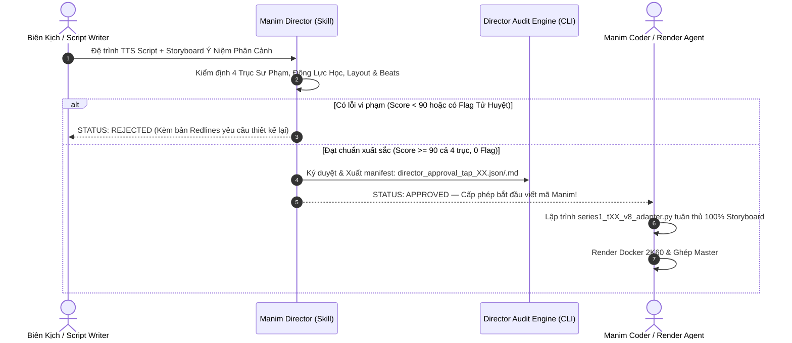

# Manim Director — Autonomous Art & Pedagogy Gatekeeper (v1.0)

> *"Người thợ kỹ thuật lo toan cú pháp và dòng lệnh; người Đạo diễn nắm giữ linh hồn và thị giác của tác phẩm. Tuyệt đối không để những vụn vặt của Docker, FFmpeg hay lỗi cú pháp kéo chìm tính sư phạm đỉnh cao và mỹ cảm toán học của điện ảnh giáo dục. Không có sự phê duyệt của Đạo diễn, không một dòng mã Manim nào được phép đưa vào kết xuất."*

---

## 1. Triết Lý & Vị Trí Cốt Lõi: Tách Biệt Ngữ Cảnh (Context Isolation)

### Vấn Đề Cố Hữu Của Quá Trình Sản Xuất Tự Động:
Khi một AI Agent kiêm nhiệm cả vai trò **Thiết kế hình ảnh (Director)** lẫn **Lập trình viên / Kỹ sư phòng máy (Render Engineer)**, Agent sẽ lập tức bị **"cuốn vào context sản xuất" (Production Context Contamination)**:
- Agent bị ngập chìm trong việc sửa lỗi cú pháp Python, cấu hình Docker volume, định dạng MathTex, xử lý lỗi tràn âm thanh hay lách kiểm định `freezedetect`.
- Dưới áp lực kỹ thuật đó, Agent thỏa hiệp: tạo ra các phân cảnh nghèo nàn, lười biếng — chỉ vẽ một đồ thị tĩnh đơn giản rồi đặt 2-3 hộp văn bản bên cạnh (**Hội chứng Slide Thuyết Trình**), hoặc lạm dụng hiệu ứng co giãn màn hình giả tạo.

### Giải Pháp Đột Phá — Vai Trò Độc Lập Của Manim Director:
**Manim Director** là một thực thể độc lập, đứng ngoài mọi chi tiết kỹ thuật thi công (không bận tâm tới Docker, FFmpeg hay cú pháp render). Nhiệm vụ duy nhất của Director là:
1. **Kiểm soát Sư phạm & Trực giác Toán học:** Khán giả có "nhìn thấy" bản chất toán học trước khi công thức xuất hiện không?
2. **Kiểm soát Động lực học & Vật lý Chân thực:** Chuyển động có tuân theo quy luật tự nhiên (quán tính, trọng lực, trường thế, ma sát) hay chỉ là hình ảnh chết đứng?
3. **Kiểm soát Bố cục UI/UX & Tương phản:** Tỷ lệ khung hình 58/42 có chuẩn mực không? Vùng an toàn phụ đề CC đáy màn hình $Y \in [-4.0, -2.0]$ có được bảo vệ tuyệt đối không?
4. **Phán Quyết & Cấp Phép:** Chỉ khi Storyboard đạt $\ge 90/100$ cả 4 trục và được Director đóng dấu **`STATUS: APPROVED`**, quy trình sản xuất mã nguồn và render mới được phép kích hoạt!

---

## 2. Bốn Trục Đánh Giá Của Manim Director (The 4 Director Invariant Axes)

Mỗi Scene trong kịch bản phải được Director chấm điểm độc lập trên thang 100 theo 4 trục:

```
                          MANIM DIRECTOR AUDIT RUBRIC
 ┌─────────────────────────────────────────────────────────────────────────────┐
 │ TRỤC 1: TÍNH SƯ PHẠM & TRỰC GIÁC TOÁN HỌC (Pedagogical Intuition)      [100] │
 │ • "Geometry before Algebra" — Hình học trước đại số                         │
 │ • Ẩn dụ thực tế tại Việt Nam (Logistics Cát Lái, Nhà máy Dung Quất)         │
 │ • Tiến trình nhận thức 4 bước: Hiện tượng -> Khung -> Cơ chế -> Công thức   │
 ├─────────────────────────────────────────────────────────────────────────────┤
 │ TRỤC 2: ĐỘNG LỰC HỌC VẬT LÝ & KHOA HỌC (Physical & Math Kinetics)      [100] │
 │ • Động lực học hạt, trường vector, biến dạng vi phân, dao động cơ học       │
 │ • CẤM TUYỆT ĐỐI chuyển động giả (Zero Fake Zoom, Zero Camera Shake)          │
 │ • Nhịp động lực liên tục (Kinetic flow & từ hero math entity — tracer, phase rotation, gradient flow) │
 ├─────────────────────────────────────────────────────────────────────────────┤
 │ TRỤC 3: KIẾN TRÚC BỐ CỤC UI/UX & TYPOGRAPHY (Layout & Aesthetics)       [100] │
 │ • Chuẩn ZenManim CSS Tokens (Nền Obsidian #0b0f19, Neon Cyan/Gold/Emerald) │
 │ • Bố cục SplitScreen 58% Hero (Trái) / 42% Telemetry Card (Phải)            │
 │ • VÙNG AN TOÀN PHỤ ĐỀ CC: Y in [-4.0, -2.0] TRỐNG TRẢI 100%                 │
 │ • Tiêu đề H1 1 dòng duy nhất, phông Roboto/Be Vietnam Pro chuẩn kerning     │
 ├─────────────────────────────────────────────────────────────────────────────┤
 │ TRỤC 4: BIÊN ĐẠO NHỊP ĐIỆU & PHÂN ĐOẠN BEATS (Rhythmic Staging)         [100] │
 │ • Mỗi scene có 3-5 Staged Beats rõ ràng, chuyển tiếp mượt mỗi 15-20s        │
 │ • Triệt tiêu hoàn toàn khoảng lặng thị giác (Visual freeze <= 20s tự nhiên) │
 │ • Hiệu ứng phát sáng Eureka Moment đúng thời điểm khai sáng tri thức        │
 └─────────────────────────────────────────────────────────────────────────────┘
```

---

## 3. Năm "Trọng Tội" Khiến Director Lập Tức Bác Bỏ (5 Cardinal Sins — Hard Rejection)

Nếu phát hiện bất kỳ dấu hiệu nào dưới đây trong thiết kế Scene, Director lập tức cấp trạng thái **`STATUS: REJECTED`** và yêu cầu thiết kế lại từ đầu:

1. ❌ **`FLAG_SLIDE_DECK` (Bệnh Slide Thuyết Trình):**
   - Phân cảnh chỉ gồm các hộp chữ nhật chứa gạch đầu dòng văn bản mà không có mô phỏng hình học toán học hoạt động ở vị trí Hero Stage.
   - *Quy tắc:* Toán học và chuyển động vật lý phải chiếm $\ge 70\%$ diện tích và sự chú ý của phân cảnh.

2. ❌ **`FLAG_FAKE_MOTION` (Gian Lận Chuyển Động Giả):**
   - Sử dụng các vòng lặp co giãn màn hình `scale(1.025) / scale(0.975)`, trôi dạt camera hoặc hiệu ứng rung giật nhân tạo để lách bài test freeze.
   - *Quy tắc:* Camera phải tĩnh 100% như bàn thạch. Chuyển động PHẢI sinh ra từ bản thân vật thể toán học.

3. ❌ **`FLAG_MATH_BEFORE_INTUITION` (Đại Số Đi Trước Trực Giác):**
   - Đưa công thức phức tạp ra màn hình trước khi người xem nhìn thấy mô hình hình học hoặc hiện tượng vật lý tương ứng.
   - *Quy tắc:* Người xem phải thấu hiểu "tại sao nó lại thế" qua hình ảnh trước khi nhìn thấy biểu thức đại số.

4. ❌ **`FLAG_CC_COLLISION` (Xâm Phạm Vùng An Toàn Phụ Đề):**
   - Đặt mobject, đồ thị, trục tọa độ hay thẻ chữ lấn vào tọa độ đáy $Y \in [-4.0, -2.0]$.
   - *Quy tắc:* Khu vực này là thánh địa bất khả xâm phạm dành cho phụ đề YouTube đa ngôn ngữ trên màn hình TV và máy tính.

5. ❌ **`FLAG_MONOTONOUS_FREEZE` (Đóng Băng Đơn Điệu):**
   - Thiết kế cảnh để một hình ảnh tĩnh đứng yên quá 25 giây mà không có bất kỳ diễn tiến hình học, đổi màu tham số hay mở rộng phân tầng nào.
   - *Quy tắc:* Phải phân rã thành các Staged Beats kế tiếp nhau theo nhịp lời thoại (15–20s/beat).

---

## 4. Chu Trình Làm Việc & Phê Duyệt Của Manim Director



---

## 5. Cấu Trúc Storyboard Phải Đệ Trình Lên Director

Trước khi viết bất kỳ file `.py` Manim nào, Agent phải đệ trình tài liệu `storyboard_tap_XX.md` gồm đầy đủ các mục sau cho từng Scene:

```markdown
### Scene [ID]: [Tên Phân Cảnh]
- **Thời lượng dự kiến:** [XX] giây (Khớp file âm thanh scene_XX.wav)
- **Ý niệm sư phạm cốt lõi:** [1 câu khẳng định người xem sẽ ngộ ra điều gì sau cảnh này]
- **Ẩn dụ trực quan & Vật lý:** [Mô tả chi tiết: Quả cầu rơi trong thung lũng 3D / Đòn cân bằng đồng / ...]
- **Bố cục không gian ZenManim CSS:**
  * Khung hình: SplitScreenLayout (58% Trái / 42% Phải)
  * Left Hero Stage: [Mô tả hình học toán học chính, tọa độ, màu sắc]
  * Right Telemetry Sidebar: [Tiêu đề H2, MetricBadge, Card công thức]
  * Vùng an toàn CC: Xác nhận đáy Y in [-4.0, -2.0] hoàn toàn rỗng.
- **Biên đạo nhịp chuyển động (Staged Kinetic Beats):**
  * *Beat 1 (0s - 18s):* [Hành động hình học bắt đầu]
  * *Beat 2 (18s - 38s):* [Biến thiên tham số, tác động lực]
  * *Beat 3 (38s - 58s):* [Hiện tượng nghịch lý hoặc xung đột toán học]
  * *Beat 4 (58s - 78s):* [Lời giải, cân bằng mới, phát sáng Eureka Flash]
  * *Beat 5 (78s - Hết):* [Đóng gói công thức, giữ khung hình trang nhã]
```

---

## 6. Chốt Chặn Kiểm Tra Tự Động (The Hard Programmatic Gate)

Để đảm bảo không một ai (kể cả AI lười biếng) có thể bỏ qua bước Director Approval, file `assets/scripts_video/manim_director.py` cung cấp hàm chốt chặn bắt buộc:

```python
from manim_director import verify_director_approval

# Kiểm tra nghiêm ngặt trước khi chạy render
verify_director_approval(episode="tap_02")
```

Nếu file phê duyệt `assets/scripts_video/director_approvals/director_approval_tap_02.json` không tồn tại, hoặc có trường `"status": "REJECTED"`, chương trình sẽ lập tức ném ngoại lệ `PermissionError` và dừng toàn bộ tiến trình render:

```
RuntimeError: ⛔ [MANIM DIRECTOR GATE] Chặn đứng quy trình sản xuất!
Tập phim tap_02 CHƯA ĐƯỢC MANIM DIRECTOR PHÊ DUYỆT.
Vui lòng hoàn thiện Storyboard và kích hoạt Manim Director để cấp phép trước khi render!
```

---

## 7. Quy Chuẩn Vàng Của Đạo Diễn Cho Một Số Chủ Đề Toán Học Kinh Điển

1. **Gradient Descent (Tập 02):**
   - *Sai lầm thường gặp:* Vẽ 1 parabol phẳng 2D và 1 dấu chấm chạy qua chạy lại.
   - *Chuẩn Đạo Diễn:* Bề mặt hàm mất mát 3D hiển thị bằng các đường đồng mức (contour lines) phát sáng. Người leo núi mù dò bước trong đêm tối; véc-tơ gradient xuất hiện tức thời chỉ hướng dốc nhất; bước chân đi ngược hướng; khi gặp hẻm núi sâu hẹp (ravine 10:1), quả cầu dao động dữ dội qua hai vách đá; vector Momentum xuất hiện màu ngọc lục bảo tích lũy vận tốc đẩy quả cầu lao băng băng dọc lòng khe suối!

2. **Không Gian Vector & Embedding (Tập 03):**
   - *Sai lầm thường gặp:* Liệt kê danh sách từ ngữ và số chiều dạng bảng tính.
   - *Chuẩn Đạo Diễn:* Không gian vũ trụ ngữ nghĩa đa chiều. Các từ ngữ là những thiên thể phát sáng. Phép chiếu trực giao (orthogonal projection) bộc lộ khoảng cách góc Cosine Similarity. Phép biến hình không gian ma trận làm xoay và co giãn toàn bộ các cụm từ vựng có liên quan!

3. **Cơ Chế Attention (Tập 11):**
   - *Sai lầm thường gặp:* Vẽ vài mũi tên nối từ này sang từ khác.
   - *Chuẩn Đạo Diễn:* Ngọn đèn pin Query soi rọi qua các chìa khóa Key. Tích vô hướng $Q K^T$ bùng lên ánh sáng tương quan ma trận nhiệt (heatmap). Bộ lọc Softmax làm tối các từ không liên quan và dồn toàn bộ năng lượng ánh sáng vào token quyết định mang giá trị Value!

---

## 8. Lệnh Kích Hoạt & Sử Dụng

```bash
# Đệ trình kịch bản và chạy kiểm toán Manim Director cho 1 tập
python3 assets/scripts_video/manim_director.py audit --episode tap_02 --storyboard assets/scripts_video/series_01/tap_02_gradient/storyboard_v8.md

# Kiểm tra trạng thái phê duyệt của Director
python3 assets/scripts_video/manim_director.py status --episode tap_02

# Xem bản báo cáo thẩm định chi tiết của Director
cat assets/scripts_video/director_approvals/director_approval_tap_02.md
```
