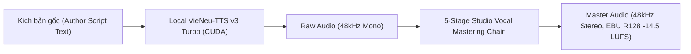

# Vietnamese Expressive TTS — Tiêu Chuẩn Gold TTS V0 (Direct Raw Script Synthesis)

> **QUY CHUẨN BẮT BUỘC TOÀN CỤC (GLOBAL GOLD STANDARD):**
> Kể từ phiên bản 2.0, hệ thống chuyển giao hoàn toàn sang **TTS V0 (Direct Raw Script Synthesis)** với động cơ cốt lõi là **Local VieNeu-TTS v3 Turbo trên CUDA** (NVIDIA Quadro RTX 5000 16GB).
> 
> **BÃI BỎ HOÀN TOÀN TTS V8:**
> - Toàn bộ các cơ chế tiền xử lý văn bản, khóa từ ghép cưỡng bức, ma trận 24 Wave và từ điển `prosody_dictionary.json` của V8 chính thức được **bãi bỏ**.
> - **Đọc thẳng từ kịch bản:** Động cơ tiếp nhận 100% văn bản kịch bản gốc tự nhiên từ tác giả, tận dụng năng lực phân tích ngữ điệu nơ-ron tự nhiên của VieNeu-TTS v3 Turbo.
> - **Chuỗi Master 5 Giai Đoạn:** Âm thanh đầu ra được xử lý qua chuỗi mastering chuẩn phát thanh quốc tế (48kHz Stereo, EBU R128 -14.5 LUFS).

---

## 1. Kiến Trúc Kỹ Thuật TTS V0



### 1.1. Triết Lý: Đọc Thẳng Tự Nhiên (Raw Script First)
- Ngôn ngữ tiếng Việt có sự mềm mại và nhạc tính tự nhiên qua hệ thống thanh điệu. Việc dùng các biểu thức chính quy (regex) thô sơ để chèn dấu câu, băm nhỏ câu văn như ở V8 làm mất đi ngữ cảnh rộng của câu, gây giật cục và sai lệch ngữ điệu.
- TTS V0 cho phép mô hình ngôn ngữ nơ-ron đọc toàn bộ câu văn trong ngữ cảnh tự nhiên, tái hiện đúng nhịp thở, độ ngân nga và sự trầm ấm của giọng đọc.

### 1.2. Môi Trường Thực Thi
- **Môi trường Python:** `/home/zen/hermes-agent/vieneu_tts_test/.venv/bin/python`
- **Mã nguồn thực thi:** `assets/scripts_video/tts_v0_synthesizer.py`
- **Voice Clone:** `assets/voices/Zen Mien Tay/zenpham-zen-meditation-mientay.wav`

---

## 2. Chuỗi Master Giọng Đọc Phòng Thu 5 Giai Đoạn

Mọi audio sau khi inference từ VieNeu-TTS v3 Turbo đều được xử lý qua bộ lọc master:

```bash
ffmpeg -y -i input_raw.wav \
  -af "highpass=f=80, equalizer=f=300:t=q:w=1.5:g=-2.0, equalizer=f=3800:t=q:w=1.2:g=3.0, treble=g=3.5:f=9000:t=s, loudnorm=I=-14.5:TP=-1.5:LRA=7.0" \
  -ar 48000 -ac 2 output_master.wav
```

1. **Highpass 80Hz:** Loại bỏ tiếng ù rền cơ học tần số thấp.
2. **De-mud EQ (300Hz, Q=1.5, -2.0dB):** Giảm độ ồm rung vùng trung trầm.
3. **Presence EQ (3.8kHz, Q=1.2, +3.0dB):** Tăng cường độ rõ của phụ âm, giúp phát âm sáng rõ, tách bạch.
4. **Air Treble Shelf (9kHz, +3.5dB):** Mở rộng dải cao, tạo cảm giác thoáng đãng, sang trọng.
5. **EBU R128 Loudnorm:** Integrated Loudness **-14.5 LUFS**, True Peak **-1.5 dBTP**, LRA **7.0**.

---

## 3. Cách Sử Dụng Trong Quy Trình Sản Xuất

### Lệnh CLI:
```bash
/home/zen/hermes-agent/vieneu_tts_test/.venv/bin/python assets/scripts_video/tts_v0_synthesizer.py \
  --text "Văn bản kịch bản gốc tiếng Việt..." \
  --output path/to/output.wav
```

### Gọi từ Python:
```python
from tts_v0_synthesizer import TtsV0Engine

engine = TtsV0Engine()
engine.synthesize(raw_text=script_content, output_wav=output_path)
```
