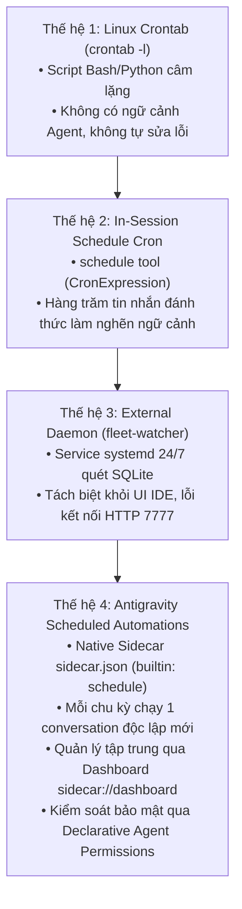
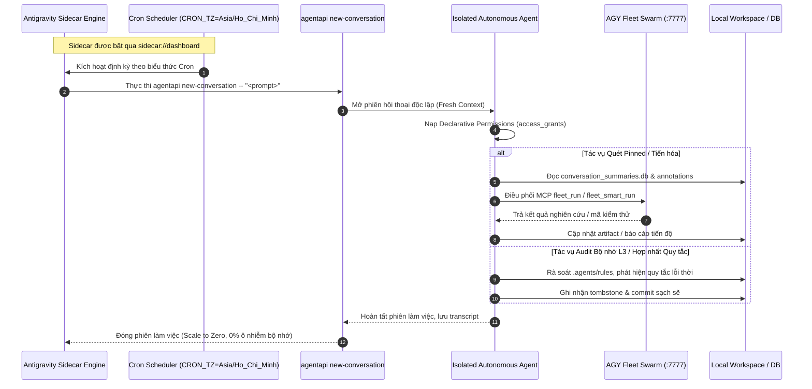

# Antigravity Scheduled Automations: Kiến trúc & Chuẩn Hóa Vận Hành 24/7

> **Phiên bản**: 1.0.0 — Production Standard  
> **Áp dụng cho**: Toàn bộ hệ sinh thái Hermes Agent, AGY Fleet Swarm, Zencode Enterprise, và Content Factory.  
> **Mục tiêu**: Chuẩn hóa toàn bộ các tác vụ định kỳ, audit bộ nhớ, giám sát dự án ghim (pinned conversations), và tiến trình tự động từ các cron job phân mảnh sang **Antigravity Scheduled Automations** nguyên bản.

---

## 1. Bối cảnh & Tiến hóa 4 Thế hệ Lập lịch (4 Generations of Cron)

Hệ thống điều hành và giám sát tác vụ định kỳ đã trải qua 4 thế hệ tiến hóa:



### 1.1. So sánh chi tiết giữa các thế hệ

| Tiêu chí | Gen 1: OS Crontab | Gen 2: In-Session Schedule | Gen 3: Standalone Daemon | Gen 4: Antigravity Sidecar |
|---|---|---|---|---|
| **Cơ chế kích hoạt** | Cron daemon hệ điều hành | Vòng lặp `schedule` trong phiên chat | Systemd daemon kiểm tra idle 20s | Antigravity engine tích hợp (`"builtin": "schedule"`) |
| **Cách ly ngữ cảnh** | Không có Agent | **Kém**: Chèn tin nhắn vào phiên hiện tại | Gửi message vào phiên cũ qua `agentapi` | **Tối ưu**: Khởi tạo phiên hội thoại mới hoàn toàn |
| **Ảnh hưởng Token** | Không | **Gây cạn kiệt**: Phình to lịch sử trò chuyện | Tiêu hao quota phiên ghim cũ | **Sạch sẽ**: Phiên mới kết thúc và lưu trữ riêng |
| **Giao diện quản lý** | Dòng lệnh `crontab -e` | Không có (chỉ thấy trong chat) | CLI `fleet-watcher status` | **Dashboard trực quan**: `sidecar://dashboard` |
| **Kiểm soát quyền** | Quyền Unix người dùng | Thừa hưởng quyền phiên chat | Không có sandbox quyền Agent | **Phân quyền khai báo**: `agent_permissions` |

---

## 2. Kiến trúc Antigravity Scheduled Automations

### 2.1. Vòng đời Kích hoạt (Execution Lifecycle)



---

## 3. Quy chuẩn Cấu hình `sidecar.json` (Specification Standard)

Mỗi automation là một sidecar thư mục con tại `<configDir>/sidecars/<sidecar-id>/sidecar.json` tuân theo chuẩn bất biến:

### 3.1. Schema Quy chuẩn
```json
{
  "builtin": "schedule",
  "args": [
    "CRON_TZ=Asia/Ho_Chi_Minh <cron_expression>",
    "agentapi",
    "new-conversation",
    "--",
    "<self_contained_prompt>"
  ],
  "restart_policy": "always",
  "display_name": "<Human Readable Name>",
  "description": "<Mô tả tần suất, múi giờ và chức năng>",
  "agent_permissions": {
    "workspace_uris": [
      "file:///absolute/path/to/workspace"
    ],
    "access_grants": [
      "command(<binary_with_subcommand>)",
      "read_file(<absolute_path>)",
      "write_file(<absolute_path>)",
      "mcp(<server_name>/<tool_name>)"
    ]
  }
}
```

### 3.2. Ba nguyên tắc bất biến (Zero-Hallucination & Security Invariants)
1. **Tiền tố múi giờ bắt buộc**: Mọi biểu thức cron phải có tiền tố `CRON_TZ=Asia/Ho_Chi_Minh` để bảo đảm khớp giờ Việt Nam (ICT, UTC+7).
2. **Dấu ngăn cách `--`**: Luôn đặt `--` ngay trước chuỗi prompt để phân tách an toàn giữa tham số của `agentapi new-conversation` và nội dung chỉ thị.
3. **Cấp quyền tối giản, nói không với Wildcard**: Tuyệt đối không dùng `command(*)`, `read_file(*)`, `mcp(*)`. Mọi quyền truy cập phải chỉ định đường dẫn tuyệt đối hoặc lệnh con cụ thể đã được kiểm chứng trên máy trạm.

---

## 4. Danh mục 5 Automations Trọng điểm

### 4.1. `pinned-evolution-scout` (Quét & Đẩy Tiến độ Dự án Ghim)
- **ID thư mục**: `pinned-evolution-scout`
- **Tên hiển thị**: `Pinned Projects Autonomous Evolution Scout`
- **Tần suất**: Mỗi 30 phút (`CRON_TZ=Asia/Ho_Chi_Minh */30 * * * *`)
- **Nhiệm vụ**: Đọc danh sách các dự án đang ghim (`pinned:true`) trong `conversation_summaries.db`, xác định các dự án đang ở trạng thái idle, chạy `fleet-watcher scan --dry-run` và phân phối tác vụ nghiên cứu / mở rộng kiểm thử qua AGY Fleet.
- **Quyền hạn**:
  - `command(fleet-watcher status)`
  - `command(fleet-watcher scan --dry-run)`
  - `read_file(/home/zen/.gemini/antigravity/conversation_summaries.db)`
  - `read_file(/home/zen/.gemini/antigravity/annotations)`
  - `mcp(agy-fleet/fleet_run)`
  - `mcp(agy-fleet/fleet_smart_run)`

### 4.2. `memory-curator-l3-audit` (Audit Bộ nhớ Chuẩn tắc L3)
- **ID thư mục**: `memory-curator-l3-audit`
- **Tên hiển thị**: `Memory Curator L3 Weekly Normative Audit`
- **Tần suất**: Định kỳ Chủ Nhật hàng tuần lúc 03:00 ICT (`CRON_TZ=Asia/Ho_Chi_Minh 0 3 * * 0`)
- **Nhiệm vụ**: Thay thế crontab `memory_curator_l3.py`. Kiểm tra tri thức chuẩn tắc L3 (`AGENTS.md`, `.agents/rules/`), phát hiện tri thức xung đột/lỗi thời, tạo tombstone và ghi nhận thay đổi có bằng chứng.
- **Quyền hạn**:
  - `workspace_uris`: `["file:///home/zen/hermes-agent"]`
  - `command(/home/zen/hermes-agent/.venv/bin/python .agents/skills/memory-curator/scripts/curate_l3.py --apply)`
  - `command(git status)`
  - `command(git diff)`

### 4.3. `rule-harness-daily-consolidation` (Hợp nhất Quy tắc & Quên Thông minh)
- **ID thư mục**: `rule-harness-daily-consolidation`
- **Tên hiển thị**: `Daily Agent Rules Consolidation & Forgetting Audit`
- **Tần suất**: Hàng ngày lúc 04:15 ICT (`CRON_TZ=Asia/Ho_Chi_Minh 15 4 * * *`)
- **Nhiệm vụ**: Thay thế crontab `rule_harness_consolidator.py`. Quét các quy tắc hoạt động, tối ưu độ dài ngữ cảnh, dọn dẹp các ngữ cảnh mô hình cũ không còn sử dụng.
- **Quyền hạn**:
  - `workspace_uris`: `["file:///home/zen/zencode-ent"]`
  - `command(/usr/bin/python3 /home/zen/zencode-ent/router/rule_harness_consolidator.py --consolidate)`

### 4.4. `teamwork-sentinel-liveness` (Giám sát Tiến độ & Sống còn Swarm)
- **ID thư mục**: `teamwork-sentinel-liveness`
- **Tên hiển thị**: `Teamwork Swarm Liveness & Progress Sentinel`
- **Tần suất**: Mỗi 15 phút (`CRON_TZ=Asia/Ho_Chi_Minh */15 * * * *`)
- **Nhiệm vụ**: Thay thế cụm Cron 1 (Progress Reporting) và Cron 2 (Liveness Check) từng chạy nội phiên trong `d9db2920`. Quét `.agents/teamwork/`, kiểm tra `progress.md` và `BRIEFING.md`, phát hiện subagent bị treo (>20 phút) và báo cáo ngắn gọn.
- **Quyền hạn**:
  - `workspace_uris`: `["file:///home/zen/zencode-ent", "file:///home/zen/workspace"]`
  - `read_file(/home/zen/zencode-ent/.agents/teamwork)`
  - `read_file(/home/zen/workspace/agy-pinned-monitor/.agents/teamwork)`
  - `command(git status)`

### 4.5. `content-factory-segmentation` (Batch Phân đoạn Video)
- **ID thư mục**: `content-factory-segmentation`
- **Tên hiển thị**: `Content Factory Video Segmentation Batch Pipeline`
- **Tần suất**: Mỗi giờ tại phút thứ 00 (`CRON_TZ=Asia/Ho_Chi_Minh 0 * * * *`)
- **Nhiệm vụ**: Thay thế crontab `batch_segment_eporner.py`. Xử lý các lô video đầu vào, cắt ghép cảnh 2K/4K và kiểm tra chất lượng âm thanh EBU R128 chuẩn -14.5 LUFS.
- **Quyền hạn**:
  - `workspace_uris`: `["file:///home/zen/hermes-agent"]`
  - `command(/usr/bin/python3 /home/zen/hermes-agent/assets/scripts_video/batch_segment_eporner.py --cron)`

---

## 5. Hướng dẫn Vận hành & Kích hoạt trên Dashboard

1. **Khởi tạo tệp sidecar**: Các tệp `sidecar.json` được ghi vào `~/.gemini/config/sidecars/<sidecar-id>/sidecar.json`.
2. **Kích hoạt an toàn**: Theo quy định an toàn hệ thống, Agent không tự ý sửa đổi `user_config.json`. Người dùng chỉ cần mở dashboard bằng liên kết:
   👉 **[Mở Automations Dashboard](sidecar://dashboard)**
3. **Bật/Tắt bằng một click**: Tìm các Automation tương ứng (`display_name`) và bật công tắc **Enable**.
4. **Giám sát lịch sử**: Mọi lần chạy định kỳ sẽ tự động xuất hiện thành một phiên hội thoại riêng biệt trong danh sách hội thoại của Antigravity, có gắn nhãn Automation tương ứng, dễ dàng kiểm tra kết quả và audit lịch sử.
