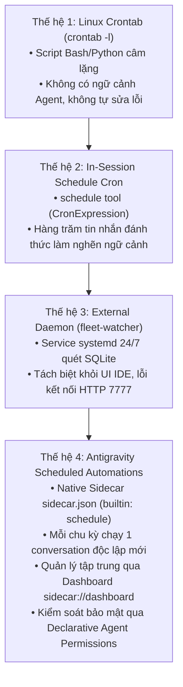
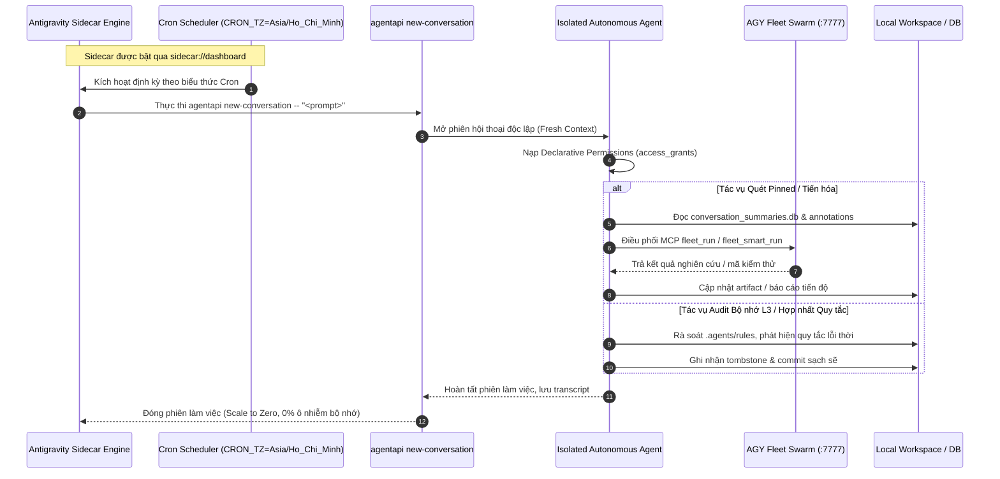
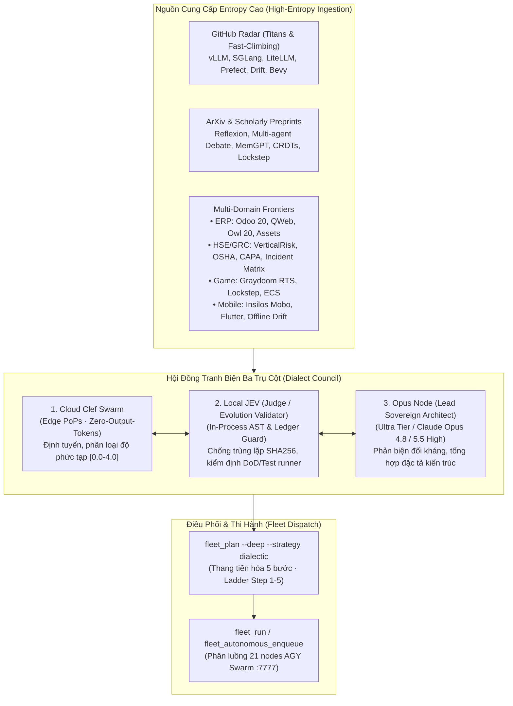

# Antigravity Scheduled Automations: Kiến trúc & Chuẩn Hóa Vận Hành 24/7

> **Phiên bản**: 1.0.0 — Production Standard  
> **Áp dụng cho**: Toàn bộ hệ sinh thái Hermes Agent, AGY Fleet Swarm, Zencode Enterprise, và Content Factory.  
> **Mục tiêu**: Chuẩn hóa toàn bộ các tác vụ định kỳ, audit bộ nhớ, giám sát dự án ghim (pinned conversations), và tiến trình tự động từ các cron job phân mảnh sang **Antigravity Scheduled Automations** nguyên bản.

---

## 1. Bối cảnh & Tiến hóa 4 Thế hệ Lập lịch (4 Generations of Cron)

Hệ thống điều hành và giám sát tác vụ định kỳ đã trải qua 4 thế hệ tiến hóa:



### 1.1. So sánh chi tiết giữa các thế hệ

| Tiêu chí | Gen 1: OS Crontab | Gen 2: In-Session Schedule | Gen 3: Standalone Daemon | Gen 4: Antigravity Sidecar |
|---|---|---|---|---|
| **Cơ chế kích hoạt** | Cron daemon hệ điều hành | Vòng lặp `schedule` trong phiên chat | Systemd daemon kiểm tra idle 20s | Antigravity engine tích hợp (`"builtin": "schedule"`) |
| **Cách ly ngữ cảnh** | Không có Agent | **Kém**: Chèn tin nhắn vào phiên hiện tại | Gửi message vào phiên cũ qua `agentapi` | **Tối ưu**: Khởi tạo phiên hội thoại mới hoàn toàn |
| **Ảnh hưởng Token** | Không | **Gây cạn kiệt**: Phình to lịch sử trò chuyện | Tiêu hao quota phiên ghim cũ | **Sạch sẽ**: Phiên mới kết thúc và lưu trữ riêng |
| **Giao diện quản lý** | Dòng lệnh `crontab -e` | Không có (chỉ thấy trong chat) | CLI `fleet-watcher status` | **Dashboard trực quan**: `sidecar://dashboard` |
| **Kiểm soát quyền** | Quyền Unix người dùng | Thừa hưởng quyền phiên chat | Không có sandbox quyền Agent | **Phân quyền khai báo**: `agent_permissions` |

---

## 2. Kiến trúc Antigravity Scheduled Automations

### 2.1. Vòng đời Kích hoạt (Execution Lifecycle)



---

## 3. Quy chuẩn Cấu hình `sidecar.json` (Specification Standard)

Mỗi automation là một sidecar thư mục con tại `<configDir>/sidecars/<sidecar-id>/sidecar.json` tuân theo chuẩn bất biến:

### 3.1. Schema Quy chuẩn
```json
{
  "builtin": "schedule",
  "args": [
    "CRON_TZ=Asia/Ho_Chi_Minh <cron_expression>",
    "agentapi",
    "new-conversation",
    "--",
    "<self_contained_prompt>"
  ],
  "restart_policy": "always",
  "display_name": "<Human Readable Name>",
  "description": "<Mô tả tần suất, múi giờ và chức năng>",
  "agent_permissions": {
    "workspace_uris": [
      "file:///absolute/path/to/workspace"
    ],
    "access_grants": [
      "command(<binary_with_subcommand>)",
      "read_file(<absolute_path>)",
      "write_file(<absolute_path>)",
      "mcp(<server_name>/<tool_name>)"
    ]
  }
}
```

### 3.2. Ba nguyên tắc bất biến (Zero-Hallucination & Security Invariants)
1. **Tiền tố múi giờ bắt buộc**: Mọi biểu thức cron phải có tiền tố `CRON_TZ=Asia/Ho_Chi_Minh` để bảo đảm khớp giờ Việt Nam (ICT, UTC+7).
2. **Dấu ngăn cách `--`**: Luôn đặt `--` ngay trước chuỗi prompt để phân tách an toàn giữa tham số của `agentapi new-conversation` và nội dung chỉ thị.
3. **Cấp quyền tối giản, nói không với Wildcard**: Tuyệt đối không dùng `command(*)`, `read_file(*)`, `mcp(*)`. Mọi quyền truy cập phải chỉ định đường dẫn tuyệt đối hoặc lệnh con cụ thể đã được kiểm chứng trên máy trạm.

---

## 4. Danh mục 6 Automations Trọng điểm (Bao phủ Toàn bộ Workspace)

### 4.1. `high-entropy-research-radar` (Bơm Entropy & Hội Đồng Tranh Biện Dialect Council)
- **ID thư mục**: `high-entropy-research-radar`
- **Tên hiển thị**: `High-Entropy Multi-Domain Research & Dialect Council Scout`
- **Tần suất**: Mỗi 2 giờ (`CRON_TZ=Asia/Ho_Chi_Minh 0 */2 * * *`)
- **Nhiệm vụ**: Bơm entropy học thuật và công nghệ mở từ GitHub Trending, ArXiv, Tech Feeds vào các routines nghiên cứu thuộc 4 miền dự án trọng điểm (/O20, /VerticalRisk, /Graydoom, /insilos_mobile). Triệu tập **Dialect Council** (Cloud Clef + Local JEV + Opus Node) để phê duyệt giải pháp và phân phối `fleet_plan` / `fleet_run` qua AGY Fleet Swarm.
- **Quyền hạn**:
  - `workspace_uris`: `["file:///home/zen/O20", "file:///home/zen/VerticalRisk", "file:///home/zen/Graydoom", "file:///home/zen/insilos_mobile", "file:///home/zen/workspace", "file:///home/zen/hermes-agent", "file:///home/zen/zencode-ent"]`
  - `command(fleet-watcher status)`
  - `command(fleet-watcher scan --dry-run)`
  - `command(fleet-watcher scout-repos)`
  - `command(fleet-watcher research)`
  - `command(fleet-watcher plan)`
  - `read_file(/home/zen/O20)`
  - `read_file(/home/zen/VerticalRisk)`
  - `read_file(/home/zen/Graydoom)`
  - `read_file(/home/zen/insilos_mobile)`
  - `read_file(/home/zen/.gemini/antigravity/conversation_summaries.db)`
  - `read_file(/home/zen/.gemini/antigravity/annotations)`

### 4.2. `pinned-evolution-scout` (Quét & Đẩy Tiến độ Dự án Ghim Toàn Diện)
- **ID thư mục**: `pinned-evolution-scout`
- **Tên hiển thị**: `Pinned Projects Autonomous Evolution Scout`
- **Tần suất**: Mỗi 30 phút (`CRON_TZ=Asia/Ho_Chi_Minh */30 * * * *`)
- **Nhiệm vụ**: Bao phủ toàn bộ các dự án ghim tại `/O20`, `/VerticalRisk`, `/Graydoom`, `/insilos_mobile`, `/hermes-agent`, `/zencode-ent`. Đọc trạng thái idle trong `conversation_summaries.db`, chạy `fleet-watcher scan --dry-run`, điều phối tiến hóa kiểm thử đối kháng và nâng cấp kiến trúc qua AGY Fleet.
- **Quyền hạn**:
  - `workspace_uris`: `["file:///home/zen/O20", "file:///home/zen/VerticalRisk", "file:///home/zen/Graydoom", "file:///home/zen/insilos_mobile", "file:///home/zen/workspace", "file:///home/zen/hermes-agent", "file:///home/zen/zencode-ent"]`
  - `command(fleet-watcher status)`
  - `command(fleet-watcher scan --dry-run)`
  - `command(fleet-watcher scout-repos)`
  - `command(fleet-watcher research)`
  - `command(fleet-watcher plan)`
  - `read_file(/home/zen/O20)`
  - `read_file(/home/zen/VerticalRisk)`
  - `read_file(/home/zen/Graydoom)`
  - `read_file(/home/zen/insilos_mobile)`
  - `read_file(/home/zen/.gemini/antigravity/conversation_summaries.db)`
  - `read_file(/home/zen/.gemini/antigravity/annotations)`

### 4.3. `teamwork-sentinel-liveness` (Giám sát Sống Còn & Tiến độ Swarm Toàn Dự Án)
- **ID thư mục**: `teamwork-sentinel-liveness`
- **Tên hiển thị**: `Teamwork Swarm Liveness & Progress Sentinel`
- **Tần suất**: Mỗi 15 phút (`CRON_TZ=Asia/Ho_Chi_Minh */15 * * * *`)
- **Nhiệm vụ**: Quét `.agents/teamwork/` trên toàn bộ các workspace (`/O20`, `/VerticalRisk`, `/Graydoom`, `/insilos_mobile`, `/zencode-ent`, `/workspace`). Kiểm tra mtime của `progress.md` và `BRIEFING.md`, phát hiện worker/subagent treo (>20 phút) và báo cáo trạng thái.
- **Quyền hạn**:
  - `workspace_uris`: `["file:///home/zen/O20", "file:///home/zen/VerticalRisk", "file:///home/zen/Graydoom", "file:///home/zen/insilos_mobile", "file:///home/zen/zencode-ent", "file:///home/zen/workspace", "file:///home/zen/hermes-agent"]`
  - `read_file(/home/zen/O20)`
  - `read_file(/home/zen/VerticalRisk)`
  - `read_file(/home/zen/Graydoom)`
  - `read_file(/home/zen/insilos_mobile)`
  - `read_file(/home/zen/zencode-ent/.agents/teamwork)`
  - `read_file(/home/zen/workspace/agy-pinned-monitor/.agents/teamwork)`
  - `command(git status)`

### 4.4. `content-factory-segmentation` (Batch Phân đoạn Video)
- **ID thư mục**: `content-factory-segmentation`
- **Tên hiển thị**: `Content Factory Video Segmentation Batch Pipeline`
- **Tần suất**: Mỗi giờ tại phút thứ 00 (`CRON_TZ=Asia/Ho_Chi_Minh 0 * * * *`)
- **Nhiệm vụ**: Thay thế crontab `batch_segment_eporner.py`. Xử lý lô video đầu vào, cắt ghép cảnh 2K/4K và kiểm tra chất lượng âm thanh EBU R128 (-14.5 LUFS).
- **Quyền hạn**:
  - `workspace_uris`: `["file:///home/zen/hermes-agent"]`
  - `command(/usr/bin/python3 /home/zen/hermes-agent/assets/scripts_video/batch_segment_eporner.py --cron)`
  - `read_file(/home/zen/hermes-agent/assets)`

### 4.5. `rule-harness-daily-consolidation` (Hợp nhất Quy tắc & Quên Thông minh)
- **ID thư mục**: `rule-harness-daily-consolidation`
- **Tên hiển thị**: `Daily Agent Rules Consolidation & Forgetting Audit`
- **Tần suất**: Hàng ngày lúc 04:15 ICT (`CRON_TZ=Asia/Ho_Chi_Minh 15 4 * * *`)
- **Nhiệm vụ**: Thay thế crontab `rule_harness_consolidator.py`. Quét các quy tắc hoạt động, tối ưu hóa độ dài ngữ cảnh, dọn dẹp ngữ cảnh mô hình cũ không còn sử dụng.
- **Quyền hạn**:
  - `workspace_uris`: `["file:///home/zen/zencode-ent"]`
  - `command(/usr/bin/python3 /home/zen/zencode-ent/router/rule_harness_consolidator.py --consolidate)`
  - `read_file(/home/zen/zencode-ent/router)`

### 4.6. `memory-curator-l3-audit` (Audit Bộ nhớ Chuẩn tắc L3)
- **ID thư mục**: `memory-curator-l3-audit`
- **Tên hiển thị**: `Memory Curator L3 Weekly Normative Audit`
- **Tần suất**: Chủ Nhật hàng tuần lúc 03:00 ICT (`CRON_TZ=Asia/Ho_Chi_Minh 0 3 * * 0`)
- **Nhiệm vụ**: Thay thế crontab `curate_l3.py`. Kiểm tra tri thức chuẩn tắc L3 (`AGENTS.md`, `.agents/rules/`), phát hiện tri thức lỗi thời, tạo tombstone và ghi nhận commit sạch sẽ.
- **Quyền hạn**:
  - `workspace_uris`: `["file:///home/zen/hermes-agent"]`
  - `command(/home/zen/hermes-agent/.venv/bin/python .agents/skills/memory-curator/scripts/curate_l3.py --apply)`
  - `command(git status)`
  - `command(git diff)`
  - `read_file(/home/zen/hermes-agent/.agents/rules)`
  - `read_file(/home/zen/hermes-agent/AGENTS.md)`

---

## 5. Quy trình Bơm Entropy Cao & Tranh Biện Hội Đồng (Dialect Council)



### 5.1. Ba Trụ Cột của Dialect Council
1. **Cloud Clef (Edge Fast-Path & Cognitive Routing)**:
   - Chạy trên mạng lưới Cloudflare Workers AI Edge PoPs với chi phí đầu ra $0.00 (`output_tokens == 0`).
   - Đánh giá độ phức tạp thuật toán, phân tích domain tags, và quyết định lộ trình: Fast-Path (<200ms) nếu đồng thuận $\ge 85\%$, hoặc chuyển tiếp sang phiên tranh luận sâu.
2. **Local JEV (Judge & Evolution Validator)**:
   - Đảm bảo kiểm chứng nghiêm ngặt (*Zero-Fake-Pass*): xác minh file tồn tại, phân tích cú pháp AST, và bắt buộc định dạng kiểm thử theo runner bản địa (`pytest`, `node:test`, `@odoo/hoot`, `flutter test`).
   - Tra cứu sổ cái `evolution_ledger.db` để ngăn ngừa các prompt lặp lại trong cửa sổ khử trùng lặp 2 giờ.
3. **Opus Node (Sovereign Architectural Synthesis)**:
   - Triệu tập node `ultra-2` / `pro-1` hoặc Nebula `claude-opus-4.8` để đóng vai trò Kiến trúc sư trưởng đối kháng (*Adversarial Principal Architect*).
   - Thiết lập kịch bản tranh biện đa góc nhìn: *Security Red Team* vs *Pragmatic SRE* vs *Domain Consultant* (ERP/HSE/Game/Mobile) trước khi sinh mã nguồn.

---

## 6. Hướng dẫn Vận hành & Kích hoạt trên Dashboard

1. **Khởi tạo tệp sidecar**: Toàn bộ 6 tệp `sidecar.json` đã được định vị tại `~/.gemini/config/sidecars/<sidecar-id>/sidecar.json`.
2. **Kích hoạt an toàn**: Người dùng truy cập dashboard tập trung của Antigravity để bật tự động hóa:
   👉 **[Mở Automations Dashboard](sidecar://dashboard)**
3. **Giám sát trực quan**: Mỗi chu kỳ tự động sẽ tạo ra một phiên hội thoại độc lập trong Antigravity IDE, lưu giữ đầy đủ biên bản họp của Dialect Council, kế hoạch `fleet_plan`, và kết quả thực thi `fleet_run`.

