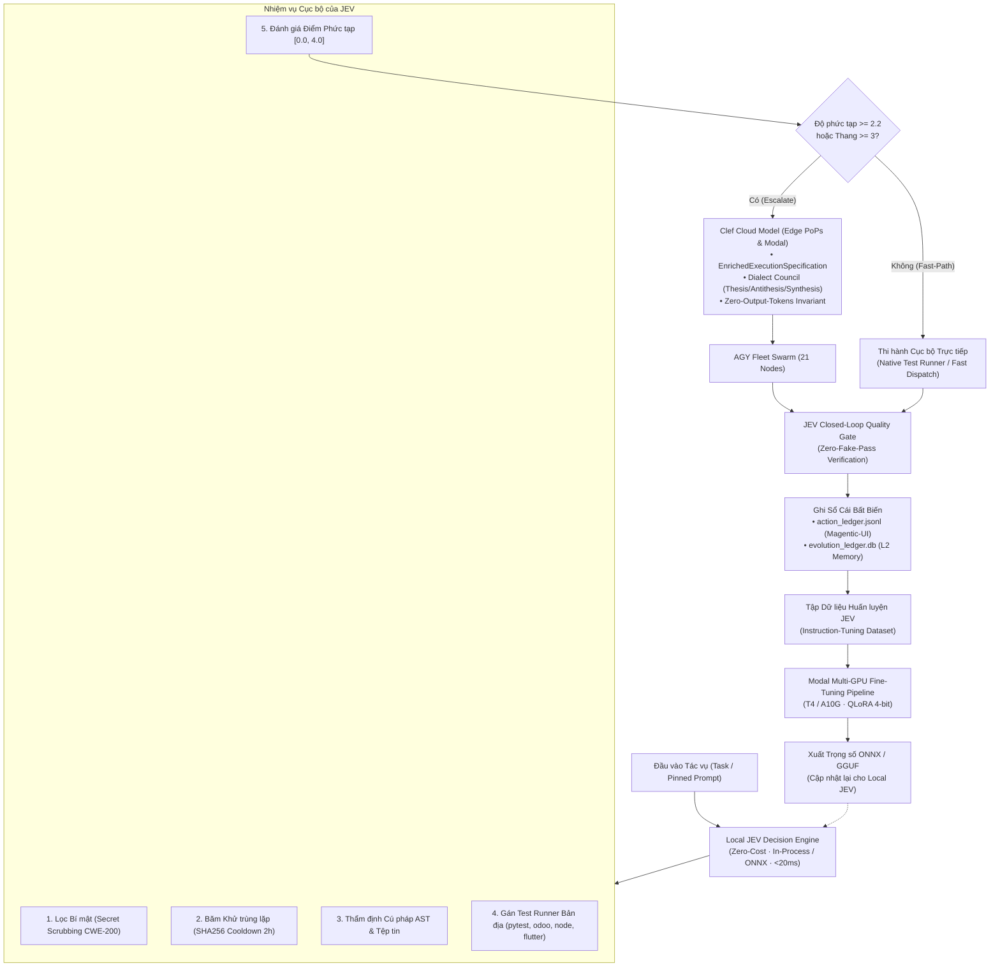
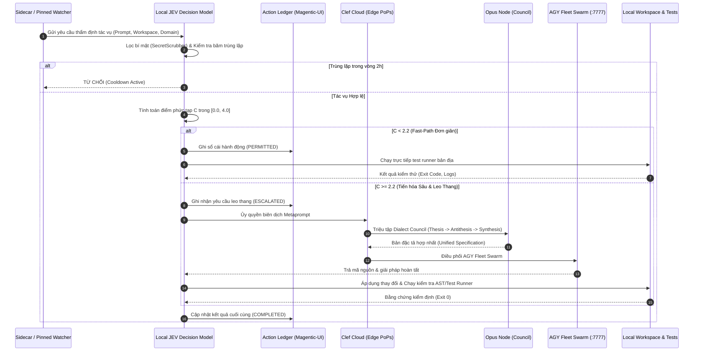

# Kiến Trúc Song Động Cơ Local JEV Decision Model & Clef Cloud Model
## Cơ Chế Hợp Nhất Bộ Nhớ, Chuẩn Hóa Agent Rules & Pipeline Fine-Tuning Trên Modal GPU

> **Tác giả**: Hội đồng Cố vấn & Kiểm định Đa ngành (Hermes Multidisciplinary Council)  
> **Phiên bản**: 2.0.0 — Production Standard  
> **Áp dụng cho**: Toàn bộ hệ sinh thái Antigravity Swarm, Hermes Agent, AGY Pinned Monitor, Odoo 20, VerticalRisk, Graydoom, và Insilos Mobile.

---

## 1. Tổng quan & Triết lý Song Động Cơ (Dual-Engine Philosophy)

Trong vận hành tự trị 24/7 (Unattended Continuous Mode), việc gửi toàn bộ các câu hỏi thăm dò, trạng thái idle, hoặc kiểm tra cú pháp lên các mô hình đám mây thương mại lớn (Frontier LLMs) dẫn đến 3 vấn đề nghiêm trọng:
1. **Lãng phí chi phí & Quota cạn kiệt**: Hàng nghìn lệnh ping/idle đốt cháy quota Claude Opus / Gemini Pro.
2. **Độ trễ cao (High Latency)**: Mỗi round-trip HTTP đám mây mất 3–15 giây, làm tắc nghẽn luồng xử lý cục bộ.
3. **Rò rỉ dữ liệu (Exfiltration Risk - CWE-200)**: Đưa ngữ cảnh nội bộ thô chưa qua thanh lọc lên mạng bên ngoài.

Để giải quyết triệt để, kiến trúc **Song Động Cơ (Dual-Engine Architecture)** phân tách rành mạch:
- **Local JEV (Judge / Evolution Validator)**: Mô hình quyết định cục bộ chạy trên máy trạm (In-Process / Quantized ONNX / GGUF). Đảm nhiệm kiểm tra nhanh (<20ms), băm khử trùng lặp (SHA256 2h), thẩm định cú pháp AST, kiểm tra file tồn tại, gán runner bản địa, và lọc an toàn bí mật (**Zero-Token Cost**).
- **Clef Cloud Model**: Mạng lưới biên Cloudflare Workers AI Free Edge PoPs kết hợp Modal GPU Escalation và Opus Node. Đảm nhiệm phân tích độ phức tạp nâng cao, mở rộng siêu chỉ thị (Metaprompting), và điều phối tranh biện hội đồng (Dialect Council).



---

## 2. Quy trình Tương tác Tuần tự (Sequence Diagram)



---

## 3. Cơ chế Hợp nhất Bộ nhớ & Quản trị Agent Rules (Clef Mnemosyne)

### 3.1. Phân tầng Ba Cấp Bộ nhớ (Tri-Tier Memory Lifecycle)

```mermaid
flowchart LR
    L1["<b>L1: Episodic Memory</b><br/>(Phiên làm việc & Nhật ký thô)<br/>• transcript.jsonl<br/>• fleet_watcher_state.json<br/>• Thời gian sống: 6 giờ"]
    --> |"Nén & Trích xuất quy luật<br/>(Daily Consolidation 04:15 ICT)"| 
    L2["<b>L2: Semantic Memory</b><br/>(Tri thức & Thống kê kinh nghiệm)<br/>• evolution_ledger.db<br/>• action_ledger.jsonl<br/>• Tỷ lệ thành công theo domain"]
    --> |"Định chuẩn & Tạo Tombstone<br/>(Weekly L3 Audit Sun 03:00 ICT)"| 
    L3["<b>L3: Normative Memory</b><br/>(Quy chuẩn bất biến & Luật lệ)<br/>• AGENTS.md<br/>• .agents/rules/*.md<br/>• resources/l3_tombstones.jsonl"]
```

### 3.2. Bảy Thao tác Quản trị Bộ nhớ (The Seven Operations)

1. **`KEEP`**: Tri thức và quy tắc vẫn đang được sử dụng và chính xác $\to$ Giữ nguyên.
2. **`MERGE`**: $\ge 2$ quy tắc hoặc bài học có nội dung trùng lặp $\to$ Gộp lại thành một phát biểu cô đọng.
3. **`COMPRESS`**: $N$ phiên làm việc L1 có chung một mẫu lỗi/thành công $\to$ Nén thành 1 bài học L2.
4. **`SUPERSEDE`**: Tri thức mới thay thế tri thức cũ (có bằng chứng kiểm chứng) $\to$ Đóng dấu thay thế và ghi nhận **Bi-Temporal Tombstone**. Tuyệt đối cấm xóa ngầm (*Silent Delete*).
5. **`ARCHIVE`**: Tri thức hết hạn sử dụng nhưng cần lưu trữ lịch sử $\to$ Chuyển vào kho lưu trữ có thể tra cứu.
6. **`QUARANTINE`**: Phát hiện mâu thuẫn giữa các quy tắc mà chưa đủ bằng chứng phân xử $\to$ Cách ly và chuyển cho Hội đồng Cố vấn quyết định.
7. **`DELETE`**: **CHỈ ÁP DỤNG** cho bí mật bị rò rỉ hoặc dữ liệu giả mạo (vi phạm *Zero-Fake-Pass*) $\to$ Cần người dùng xác nhận rõ ràng.

### 3.3. Quy chuẩn Bi-Temporal Tombstone cho Quy tắc L3
Mỗi khi một dòng quy tắc L3 bị bãi bỏ hoặc thay thế, hệ thống bắt buộc phải ghi một bản ghi vào `resources/l3_tombstones.jsonl`:
```json
{
  "tombstone_id": "tmb-20261013-001",
  "op": "SUPERSEDE",
  "tier": "L3",
  "file": ".agents/rules/02_acoustic_tts_and_subtitles_gold_standards.md",
  "line_number": 42,
  "old_text": "Sử dụng atempo để điều chỉnh thời lượng âm thanh",
  "new_text": "Zero-Atempo-Slowdown: 100% native 1.0x neural inference",
  "reason": "atempo gây méo âm sắc giọng đọc; áp dụng TTS V0-Sense",
  "superseded_by": "02_acoustic_tts_and_subtitles_gold_standards.md §1.4",
  "evidence": ["tests/test_audio_asr_closed_loop.py PASSED", "commit dd78be5a"],
  "valid_from": "2026-08-01T00:00:00Z",
  "valid_to": "2026-10-13T08:00:00Z",
  "recorded_at": "2026-10-13T08:52:00Z"
}
```

---

## 4. Pipeline Fine-Tuning JEV Trên Modal GPU (`modal_jev_finetune`)

Để mô hình Local JEV ngày càng thông minh, phản xạ chính xác theo chuẩn mực của hệ thống mà không cần tốn chi phí gọi mô hình lớn, ta thiết lập quy trình tự động huấn luyện tinh chỉnh (Fine-Tuning) định kỳ trên Modal GPU.

### 4.1. Cấu trúc Tập Dữ liệu Huấn luyện (Training Dataset Schema)
Mỗi mẫu huấn luyện là một cặp `(Instruction, Input, Output)` được chắt lọc từ các ca phân xử thành công:

```json
{
  "instruction": "Bạn là Local JEV Decision Model. Hãy thẩm định yêu cầu tác vụ, phân loại domain, tính điểm phức tạp [0.0, 4.0], chọn runner kiểm thử bản địa, và quyết định có cần leo thang lên Clef Cloud hay không.",
  "input": {
    "project_title": "Vertical Resilience Deployment",
    "workspace": "/home/zen/VerticalRisk",
    "objective": "Thêm kiểm thử đối kháng cho state machine quy trình ứng phó sự cố HSE",
    "git_branch": "main",
    "uncommitted_files": ["models/incident.py", "tests/test_incident.py"]
  },
  "output": {
    "domain": "enterprise_erp",
    "complexity_score": 2.4,
    "target_tier": "ULTRA",
    "test_runner": "odoo.tests.common.TransactionCase (odoo-bin --test-enable)",
    "requires_cloud_escalation": true,
    "verdict": "ESCALATED",
    "rationale": "Thay đổi logic nghiệp vụ HSE cốt lõi, điểm phức tạp 2.4 vượt ngưỡng 2.2, yêu cầu Dialect Council phản biện 3 trụ cột."
  }
}
```

### 4.2. Kiến trúc Huấn luyện Modal Multi-GPU
- **Nền tảng**: Modal.com (`~/.modal.toml` profile `zenllm` hoặc `insimind`).
- **Phần cứng**: 1x NVIDIA T4 (16GB VRAM) hoặc A10G (24GB VRAM).
- **Mô hình Nền**: `Qwen/Qwen2.5-Coder-1.5B-Instruct` hoặc `google/gemma-2-2b-it`.
- **Phương pháp**: **QLoRA 4-bit (NF4)** với `bitsandbytes`, $r=16, \alpha=32$, dropout=0.05.
- **Ràng buộc Chi phí**: Thời lượng huấn luyện $\le 45$ phút; ngân sách chi trả $\le \$0.45$/lần chạy trên T4 ($0.59/giờ).
- **Đầu ra**: Trọng số LoRA được sáp nhập và xuất ra:
  1. `jev_decision_model.onnx` (Dành cho runtime Python `onnxruntime` siêu tốc, chạy được trên cả CPU ThinkPad và Quadro RTX).
  2. `jev_decision_model_q4_k_m.gguf` (Dành cho `llama-cpp-python`).

---

## 5. Bảng Lệnh Vận Hành & Kiểm Định

| Mục tiêu vận hành | Lệnh thực thi | Mục đích kiểm tra |
|---|---|---|
| **Thu hoạch Dữ liệu JEV** | `python3 tools/modal_jev_finetuning.py --harvest-dataset` | Trích xuất các quyết định từ sổ cái thành tập JSONL |
| **Kiểm tra Giả lập (Dry-Run)** | `python3 tools/modal_jev_finetuning.py --dry-run` | Kiểm tra cú pháp script và dữ liệu đầu vào |
| **Chạy Train Trên Modal** | `MODAL_PROFILE=zenllm modal run tools/modal_jev_finetuning.py` | Kích hoạt container T4 huấn luyện QLoRA trên Modal |
| **Xuất Mô hình về Local** | `python3 tools/modal_jev_finetuning.py --export-onnx` | Chuyển đổi trọng số về ONNX cho máy trạm cục bộ |
| **Kiểm toán Bộ nhớ Tuần** | `python3 .agents/skills/memory-curator/scripts/curate_l3.py --apply` | Thực thi kiểm toán L3 và cập nhật tombstones |
| **Chạy Suite Test JEV** | `python3 -m pytest tests/test_jev_clef_dual_engine.py -v` | Đảm bảo 100% test suite song động cơ vượt qua |
