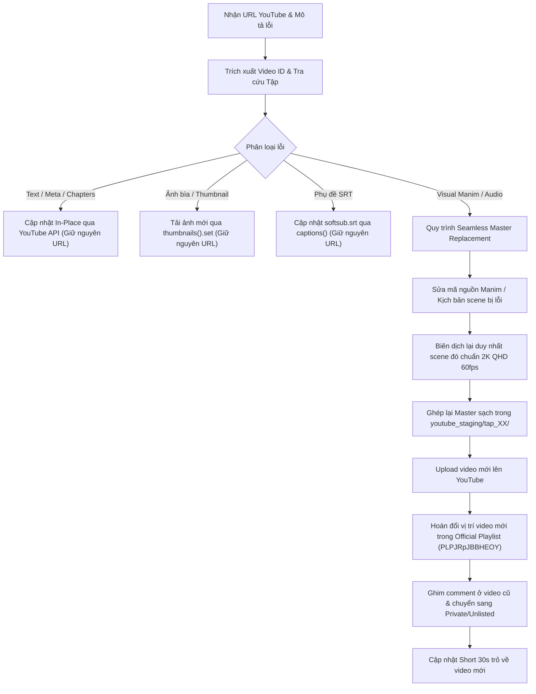

# Video Debugger — Master Workflow Guide

> *"Chất lượng không bao giờ là sự ngẫu nhiên. Khi một lỗi xuất hiện, hệ thống phải xác định chính xác tầng lỗi (Metadata, Phụ đề, Âm thanh hay Hoạt cảnh Manim) và đưa ra phương án xử lý nhanh nhất, bảo toàn dữ liệu người xem tối đa."*

## 1. Bản Chất Kỹ Thuật Nền Tảng YouTube
- **Bất biến của YouTube (Anti-Bait-and-Switch Invariant):** YouTube **tuyệt đối không cho phép upload đè file video mới lên cùng một Video ID / URL**. Đây là chính sách chống lừa đảo toàn cầu của Google nhằm ngăn chặn việc thay thế nội dung sau khi đã gom hàng triệu view.
- **Những gì sửa được trực tiếp trên URL cũ (In-Place Fixes):**
  1. `Tiêu đề (Title)`, `Mô tả (Description)`, `Chapters (Timestamps)`, `Tags`.
  2. `Ảnh bìa (Thumbnail 16:9)`.
  3. `Phụ đề (Captions / Softsub SRT)`.
  4. `Cắt bỏ đoạn lỗi ngắn (Trim / Cut)` qua YouTube Studio Video Editor.
- **Khi nào bắt buộc phải thực hiện Seamless Master Replacement:**
  Khi lỗi sai nằm ở **công thức toán học Manim, visual glitch lớn, hoặc âm thanh giọng đọc**, bắt buộc phải biên dịch lại scene Manim và xuất bản video mới thay thế.

## 2. Quy Trình Khắc Phục Tự Động (Execution Flow)



## 3. Lệnh Vận Hành

```bash
# 1. Chẩn đoán và lập kế hoạch sửa lỗi
python3 skills/creative/video-debugger/scripts/video_debugger.py \
  --url "https://youtu.be/HmFA2JUmjKg" \
  --issue "phút 02:15 công thức ma trận bị thiếu chỉ số dưới"

# 2. Định vị tài sản tự động:
#    - assets_located: script.md, manim.py, metadata.json, softsub.srt, video.mp4
```
