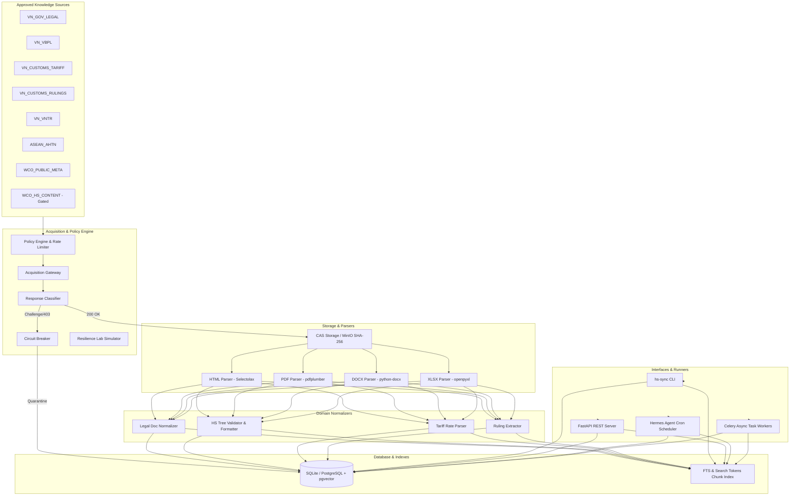

# HS Knowledge Sync Skill (`sync-hs-knowledge`)

> **Deterministic HS Classification, Tariff Schedule & Legal Normalization Engine for Hermes Agent**

`sync-hs-knowledge` is a production-grade orchestration skill and standalone data synchronization engine designed according to the **Hermes Footprint Ladder Rung 2** (CLI + Skill, zero core model tool schema footprint). It automates the acquisition, parsing, normalization, and hybrid temporal retrieval of Harmonized System (HS) codes, ASEAN Harmonized Tariff Nomenclature (AHTN), Vietnam National Tariff schedules, legal decrees/circulars, and Advance Classification Rulings.

---

## 🌟 Key Features

- **🏛️ Official-First & Evidence-First**: Every extracted provision, tariff rate, and ruling links directly to an immutable raw artifact hash (SHA-256), source URL, page citation, and temporal validity window (`valid_from` / `valid_to`).
- **🛡️ Unattended by Design & Zero Circumvention**: Implements strict no-evasion policies. Automatically detects Cloudflare Turnstile, Managed Challenges, or WAF blocks and quarantines the source without attempting unauthorized bypass or stealth spoofing.
- **🔄 Content-Addressable Storage (CAS)**: Local and S3/MinIO dual-engine file storage with automated 2-tier SHA-256 deduplication.
- **⚡ Hybrid Lexical, Semantic & Temporal Retrieval**: Query simultaneously across Legal Documents, HS 8-digit Hierarchy Nodes, and Customs Rulings with exact `as_of` temporal historical filtering.
- **📦 Dual Delivery**: Executable as a Hermes Agent skill or as a global standalone CLI binary (`hs-sync`) and REST API (FastAPI).
- **⏱️ Automated Scheduling**: 4 registered Hermes Agent cron jobs for daily incremental sync, weekly regional sync, monthly full reconciliation, and daily infrastructure health probes.

---

## 📐 Architecture Overview



---

## 🚀 Quick Start

### 1. Installation

```bash
# In your virtual environment
cd /home/zen/hermes-agent
source .venv/bin/activate

# Install skill in editable mode
pip install -e skills/sync-hs-knowledge/
```

### 2. Basic CLI Commands

```bash
# Check system and database health
hs-sync health --json

# List configured sources
hs-sync sources list --json

# Dry-run plan preview for Vietnam sources
hs-sync plan --scope vietnam-core --json

# Execute synchronization run
hs-sync run --scope vietnam-core --mode incremental --json

# Search across legal documents, HS codes, and rulings
hs-sync search "8471.30.20" --as-of "2026-08-21" --json
hs-sync search "Thông tư 85" --json

# Webhook Management
hs-sync webhook add odoo-erp "https://erp.internal/webhook" --events "hs.ruling.published,hs.tariff.changed" --secret "my-secret-key"
hs-sync webhook list
hs-sync webhook test <subscription_id>
hs-sync webhook deliver "hs.tariff.changed" '{"chapter": "84", "changed_nodes": 4}'
```

---

## 🔔 Webhook Subsystem & Event Hub

The skill provides an enterprise event dispatcher with HMAC-SHA256 signing for real-time data sync with subscribers (ERP, Odoo, Customs Clearance Platforms, Logistics Management):

- **Event Catalog**:
  - `hs.legal_doc.promulgated`: Dispatched when new laws/decrees/circulars are normalized.
  - `hs.ruling.published`: Dispatched when new advance classification rulings are published.
  - `hs.tariff.changed`: Dispatched on tariff schedule revisions or nomenclature updates.
  - `hs.sync.completed`: Dispatched upon crawl & sync cycle completion.
  - `hs.ping.test`: Dispatched on reachability verification tests.
- **Security & Integrity**: Signed with `X-HS-Signature-256: sha256=<hmac_hex>` using constant-time comparison.
- **Delivery Resilience**: Exponential backoff retry on 5xx / connection timeouts, auto-deactivation after 10 consecutive failures.

---

## 🗄️ Storage & Database Locations

| Component | Default Path | Purpose |
| :--- | :--- | :--- |
| **Relational Database** | `skills/sync-hs-knowledge/data/hs_knowledge.db` | SQLite database storing 36 relation tables, HS hierarchy, rulings, and chunk indexes. |
| **Raw Artifact Storage** | `skills/sync-hs-knowledge/data/storage/raw/sha256/` | CAS storage storing immutable raw files deduplicated by SHA-256. |
| **Source Catalog** | `skills/sync-hs-knowledge/references/source-catalog.yaml` | Declarative configuration for 8 knowledge sources. |
| **Cron Job State** | `~/.hermes/hermes.db` | Persistent Hermes Agent cron task definitions and attempt history. |

---

## ⏰ Automated Cron Schedules

| Job Name | Schedule (ICT) | Scope | Purpose |
| :--- | :--- | :--- | :--- |
| `hs-sync-daily-vietnam` | `0 2 * * *` (02:00 Daily) | `vietnam-core` | Incremental crawl of VN legal decrees, tariff notices & rulings. |
| `hs-sync-weekly-regional` | `0 2 * * 0` (02:00 Sun) | `ASEAN_AHTN`, `WCO_PUBLIC_META` | Synchronize regional ASEAN AHTN and WCO public metadata. |
| `hs-sync-monthly-reconcile` | `0 3 1 * *` (03:00 1st of month) | `vietnam-core` + All | Full DB reconciliation, hierarchy audit & manifest export. |
| `hs-sync-daily-health` | `0 6 * * *` (06:00 Daily) | Infrastructure & Sources | Connection health check and license readiness audit. |

---

## 📚 Technical Documentation & Specifications

Detailed specifications are available in the [`references/`](file:///home/zen/hermes-agent/skills/sync-hs-knowledge/references/) directory:

- [Architecture Specification](file:///home/zen/hermes-agent/skills/sync-hs-knowledge/references/architecture.md)
- [REST API Reference & Endpoints](file:///home/zen/hermes-agent/skills/sync-hs-knowledge/references/api-specs.md)
- [Database Schema & Data Models](file:///home/zen/hermes-agent/skills/sync-hs-knowledge/references/database-specs.md)
- [Normalization & Validation Rules](file:///home/zen/hermes-agent/skills/sync-hs-knowledge/references/normalization-specs.md)
- [Operations & Runbook Guide](file:///home/zen/hermes-agent/skills/sync-hs-knowledge/references/operations.md)
- [Resilience Lab & Quarantine Fixtures](file:///home/zen/hermes-agent/skills/sync-hs-knowledge/references/resilience-lab.md)
- [License & Entitlement Policy](file:///home/zen/hermes-agent/skills/sync-hs-knowledge/references/license-policy.md)

---

## 🧪 Testing & Verification

Run the comprehensive 47-test suite and the 11-stage end-to-end integration test:

```bash
# Run Pytest unit & integration test suite (47/47 tests passing)
pytest skills/sync-hs-knowledge/tests/ -v

# Run 11-stage End-to-End verification pipeline (100% Green)
python3 skills/sync-hs-knowledge/scripts/run_e2e_test.py
```

