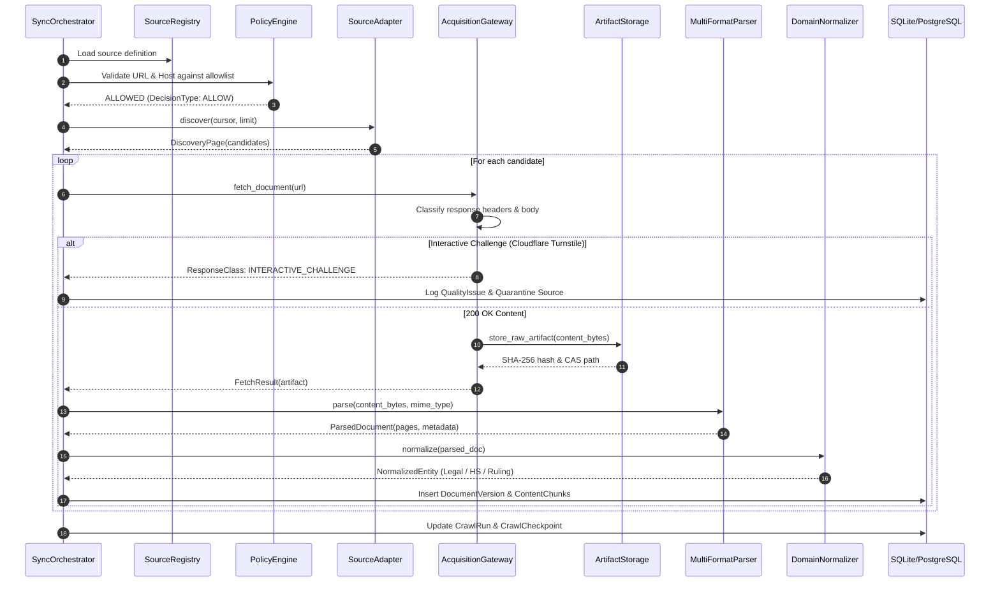
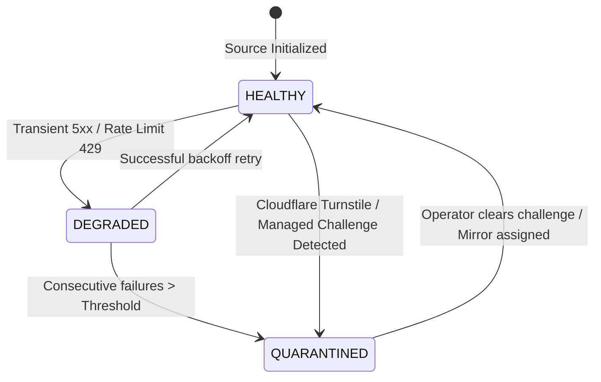
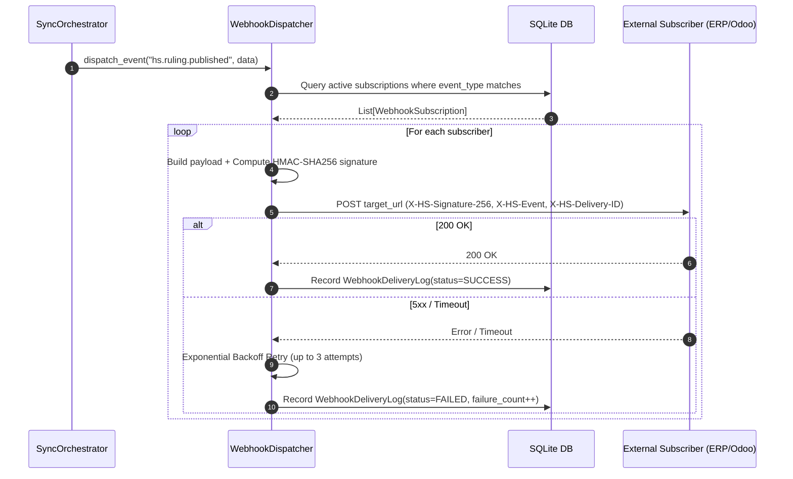

# Architecture Specification: HS Knowledge Sync System

This document specifies the technical architecture, data pipeline, and security boundaries of the `sync-hs-knowledge` skill.

---

## 1. Architectural Philosophy & Footprint Ladder

`sync-hs-knowledge` is designed strictly according to **Footprint Ladder Rung 2** (CLI + Skill):
1. **Zero Core Model Tool Footprint**: Does not register permanent function schemas to LLM turns, preserving per-conversation prompt caching.
2. **Deterministic Processing Core**: Extraction, validation, deduplication, and indexing run through deterministic Python parsers without stochastic LLM mutation of legal facts.
3. **Evidence-First Invariant**: Every indexed entity is anchored to a cryptographic SHA-256 hash, authoritative source URL, citation section, and date boundaries (`valid_from`, `valid_to`).
4. **No-Circumvention (Zero Stealth Evasion)**: Strict adherence to target site policies; challenges are detected, logged, and quarantined rather than bypassed.

---

## 2. Component Decomposition

```
skills/sync-hs-knowledge/
├── service/
│   ├── acquisition/          # Fetch Gateway, Classifier, Circuit Breakers, Resilience Lab
│   ├── adapters/             # Domain-specific source connectors (VN_GOV, VBPL, Tariff, Rulings, VNTR, AHTN)
│   ├── api/                  # FastAPI REST Server & OpenAPI Schemas
│   ├── core/                 # Source Registry, Entitlements, Policy Engine
│   ├── db/                   # SQLAlchemy 2.0 Models & Session Handlers (36 tables)
│   ├── index/                # Hybrid Lexical & Temporal Retriever
│   ├── normalization/        # Legal, HS 8-digit, Tariff, and Ruling Extractors
│   ├── parsers/              # Multi-format parsers (HTML, PDF, DOCX, XLSX, Vietnamese NFC)
│   ├── pipeline/             # Sync Orchestrator & Celery Task Worker
│   ├── storage/              # Content-Addressable Storage (CAS) Manager
│   └── webhooks/             # HMAC-SHA256 Webhook Dispatcher & Event Hub
├── data/                     # SQLite Database & Deduplicated Raw Artifacts
├── references/               # Declarative Specifications & Catalogs
├── scripts/                  # CLI Entrypoints, Migration, Resilience Lab, E2E runner
└── tests/                    # 54 Pytest Unit & Integration Tests (100% Green)
```

---

## 3. Data Ingestion & Transformation Lifecycle



---

## 4. Content-Addressable Storage (CAS) Specification

Raw content downloaded from source portals is stored using a 2-tier sub-directory sharding scheme based on the SHA-256 digest:

$$\text{Path} = \text{BASE\_DIR} / \text{raw} / \text{sha256} / h_{0..2} / h_{2..4} / h_{0..64}$$

- **Deduplication**: If 1,000 links point to identical document binaries, only **1 file** exists on disk.
- **Immutability**: Raw artifacts are write-once, read-only.
- **Dual-Engine**: Seamless fallback from S3/MinIO to local filesystem CAS.

---

## 5. Resilience & Quarantine State Machine



### Response Classification Rules
- `SUCCESS` (200 OK): Valid legal payload parsed.
- `NOT_MODIFIED` (304): ETag / Last-Modified match, bypass download.
- `RATE_LIMIT` (429): Obey `Retry-After` header + decorrelated jitter.
- `INTERACTIVE_CHALLENGE` (403 / cf-mitigated): Immediate quarantine, no automated bypass.
- `TRANSIENT` (500, 502, 503, 504): Exponential backoff.

---

## 6. Hybrid Lexical & Temporal Retrieval Algorithm

Search scores are computed dynamically combining lexical token overlap, entity authority level, and temporal validity:

$$\text{FinalScore}(q, d, t) = \mathbb{I}(t \in [d_{\text{valid\_from}}, d_{\text{valid\_to}}]) \cdot \left( w_{\text{lexical}} \cdot S_{\text{overlap}}(q, d) + w_{\text{authority}} \cdot A(d) \right)$$

Where:
- $A(d) = 1.0$ for `A1_SIGNED_OFFICIAL` (Official Gazettes, Decrees, Circulars)
- $A(d) = 0.8$ for `A2_OFFICIAL_DATABASE` (Portal Databases, Advance Rulings)
- $A(d) = 0.5$ for `A3_GOV_GUIDANCE` (VNTR Q&A, Guidance)
- $\mathbb{I}(\cdot)$ is the strict temporal indicator function filtering out revoked or not-yet-effective provisions as of date $t$.

---

## 7. Outbound Webhook Subsystem & Event Hub

The Webhook Subsystem provides push notifications to downstream subscriber systems whenever authoritative customs and legal knowledge is ingested or modified.



### Event Envelope Schema
```json
{
  "event_id": "evt_4a89bc21e901",
  "event_type": "hs.tariff.changed",
  "timestamp": "2026-08-21T02:49:00.000Z",
  "data": {
    "source_id": "VN_CUSTOMS_TARIFF",
    "chapter": "84",
    "nodes_count": 4,
    "source_url": "https://customs.gov.vn/..."
  }
}
```

### Security & Invariant Guarantees
1. **Constant-Time Verification**: Subscribers verify payloads via `hmac.compare_digest(expected, signature)`.
2. **Replay Protection**: Timestamps in `X-HS-Timestamp` header prevent replay attacks older than 300 seconds.
3. **Graceful Degradation**: Auto-deactivates endpoints after 10 consecutive failures to prevent resource exhaustion.

---

## 8. WCO HS 2028 Evolution & Vietnam Digital Customs (Decree 169/2026/NĐ-CP)

To guarantee long-term regulatory maturity, `sync-hs-knowledge` implements future-proof compliance bridges:
1. **WCO HS 2028 Multi-Cycle Compatibility**:
   - Supports forward-compatible 8-digit tariff crosswalks preparing for the WCO 2028 edition (circular economy, environmental categories, high-tech semiconductors).
2. **Decree 169/2026/NĐ-CP Integration**:
   - Automated digital cross-referencing between ERP commercial invoices and Advance Rulings (*Thông báo kết quả xác định trước mã HS*).
   - Provenance tracking with SHA-256 anchoring guarantees legal protection and zero penalty for non-tax clerical amendments under Smart Customs data-driven enforcement.

---

## 9. PDCA Maturity & Automated Governance Cycle

| Phase | System Component | Verification & Evidence |
|---|---|---|
| **Plan** | `SourceRegistry` & `PolicyEngine` | Dry-run sync planning, domain allowlist enforcement |
| **Do** | `SyncOrchestrator` & `AcquisitionGateway` | Deterministic parsing, CAS content deduplication |
| **Check** | `ResilienceLab` & `Retriever` | 54 Pytest unit/integration tests, 11-stage E2E pipeline |
| **Act** | `WebhookDispatcher` & `Insilos Connector` | Real-time event dispatch, automated ERP catalog sync |

