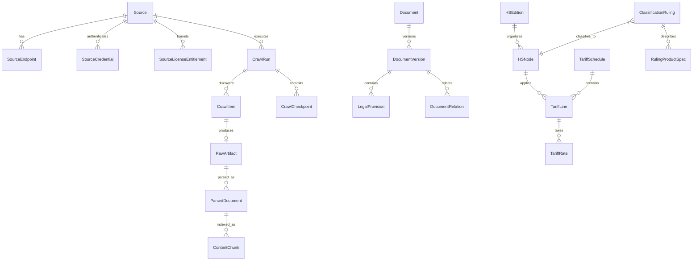

# Database Schema & Entity Specification

This document details the database schema, relational constraints, indexing strategies, and vector chunk models implementing the 36 entities defined in **SRS v1.1 Section 7**.

---

## 1. Entity-Relationship Diagram



---

## 2. Table Specifications by Subsystem

### Subsystem A: Source Registry & Entitlement Control (7 Tables)
1. `sources`: Source metadata, jurisdiction, base URL, update frequency, authority level.
2. `source_endpoints`: Specific discovery & API endpoints per source.
3. `source_credentials`: Encrypted secrets, API tokens, HTTP headers.
4. `source_license_entitlements`: Contract terms, usage limits, gating policies (`METADATA_ONLY`, `FULL_SYNC`).
5. `source_rate_limits`: Request rate caps, burst quotas, concurrency limits.
6. `source_quarantine_events`: Quarantine history, trigger reasons, operator remediation notes.
7. `source_health_metrics`: Uptime, response latency, HTTP status distributions.

### Subsystem B: Ingestion Pipeline & CAS Storage (8 Tables)
8. `crawl_runs`: Execution logs (`RUNNING`, `SUCCEEDED`, `FAILED`, `PARTIAL`), item counters.
9. `crawl_checkpoints`: Resumable cursor offsets and source sync state.
10. `crawl_items`: Discovered URLs, canonical URLs, fetch timestamps, HTTP statuses.
11. `raw_artifacts`: Content-Addressable Storage metadata, SHA-256 hash, MIME type, file size, storage path.
12. `parsed_documents`: Extracted JSON representation, parser version, language, extraction confidence.
13. `artifact_dedup_ledger`: Maps secondary URLs to existing SHA-256 artifacts.
14. `quality_issues`: Data quality flags, quarantine records, validation discrepancies.
15. `reparse_jobs`: Parser batch re-execution logs.

### Subsystem C: Legal Corpus & Provisions (6 Tables)
16. `documents`: Top-level legal instruments (Law, Decree, Circular, Decision).
17. `document_versions`: Historical revisions, authoritative level, effective date boundaries (`valid_from`, `valid_to`).
18. `legal_provisions`: Granular structural units (Chapters, Sections, Articles, Clauses, Points).
19. `document_relations`: Inter-document lineage (Replaces, Amends, Guides, References).
20. `legal_glossary`: Standard customs terms, legal definitions, multilingual aliases.
21. `authority_delegations`: Official agency issuing authorities and jurisdictions.

### Subsystem D: HS Tree & Tariff Schedule (8 Tables)
22. `hs_editions`: Nomenclature editions (e.g. HS 2022, AHTN 2022, VN Tariff 2026).
23. `hs_nodes`: Hierarchical codes (2-digit Chapter, 4-digit Heading, 6-digit Subheading, 8-digit Tariff line), Vietnamese & English descriptions.
24. `tariff_schedules`: Tariff books (MFN, EVFTA, CPTPP, ACFTA, ATIGA, Export).
25. `tariff_lines`: 8-digit tariff line item records linked to HS nodes.
26. `tariff_rates`: Ad-valorem (%), specific (VND/unit), compound, and seasonal duty rates.
27. `specialized_management_lists`: Import/export conditions, licensing requirements by ministries (MOIT, MARD, MOH, MIC).
28. `tariff_correlation_tables`: Migration mapping between old and new HS editions.
29. `wco_explanatory_notes`: Gated Explanatory Notes & Compendium entries.

### Subsystem E: Classification Rulings & Inquiries (4 Tables)
30. `classification_rulings`: Advance classification rulings (Thông báo kết quả phân loại trước mã số).
31. `ruling_product_specs`: Detailed technical specs, chemical composition, CAS numbers, commercial names.
32. `customs_inquiries_qa`: VNTR and Customs portal Q&A records.
33. `ruling_appeals`: Administrative reviews, revocations, and amendments to rulings.

### Subsystem F: Retrieval & Search Indexing (3 Tables)
34. `content_chunks`: Normalized text chunks with FTS tokens and optional vector embeddings.
35. `search_synonyms`: Domain-specific synonyms, abbreviation expansions (e.g., `PLC` $\leftrightarrow$ `Thiết bị điều khiển logic khả trình`).
36. `audit_logs`: User and system query audit trail, provenance inspection logs.

---

## 3. Indexing & Vector Search Strategies

1. **Temporal Indexing**: Composite indexes on `(valid_from, valid_to)` across `document_versions`, `tariff_rates`, and `content_chunks` for fast point-in-time filtering.
2. **HS Hierarchy Traversal**: B-tree index on `parent_code` and `code` enabling recursive CTE queries.
3. **Lexical Full-Text Search**: SQLite FTS5 / PostgreSQL `tsvector` on `search_vector_text`.
4. **Vector Search (PostgreSQL pgvector)**:
   ```sql
   CREATE EXTENSION IF NOT EXISTS vector;
   ALTER TABLE content_chunks ADD COLUMN embedding vector(768);
   CREATE INDEX idx_chunks_embedding_hnsw ON content_chunks USING hnsw (embedding vector_cosine_ops);
   ```
