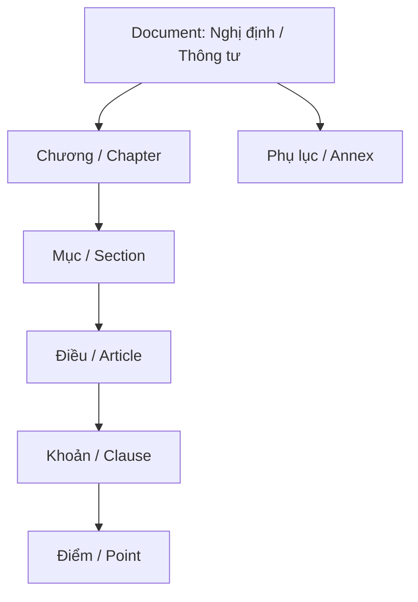

# Normalization & Validation Specification

This document defines the deterministic parsing, text normalization, structural validation, and entity extraction rules for customs legal documents, HS hierarchies, tariff rates, and classification rulings.

---

## 1. Vietnamese Unicode & Text Normalization

All raw text undergoes deterministic Unicode normalization prior to parsing:

1. **Unicode NFC Enforcement**: Converts decomposed Unicode characters (NFD) into canonical precomposed form (NFC).
2. **Whitespace Collapsing**: Replaces multiple spaces, non-breaking spaces (`\u00A0`), and tab characters with a single standard ASCII space.
3. **Punctuation Normalization**: Replaces curly quotes (`“”‘’`), typographical hyphens (`—–`), and full-width characters with standard ASCII equivalents.
4. **Token Generation**: Strips tonal marks into ASCII search tokens while preserving original accented text for high-fidelity citations.

---

## 2. Legal Document Hierarchy Extraction

Legal documents are parsed into hierarchical structural components:

### Extraction Patterns
- **Điều (Article)**: `r'(?:Điều|Article)\s+([0-9]+)\.?\s*([^\n]*)'`
- **Khoản (Clause)**: `r'^\s*([0-9]+)\.\s+([^\n]+)'`
- **Điểm (Point)**: `r'^\s*([a-zđ])\)\s+([^\n]+)'`
- **Số Hiệu Văn Bản (Doc Number)**: `r'(?:Số|No\.?)\s*:?\s*([0-9]+/[0-9A-Za-z\-/\.]+)'`
- **Ngày Ban Hành (Issuing Date)**: `r'ngày\s+([0-9]{1,2})\s+tháng\s+([0-9]{1,2})\s+năm\s+([0-9]{4})'`

---

## 3. HS Code Hierarchy Validation Rules

The HS Code tree is validated according to strict WCO and ASEAN structural standards:

| Level | Code Length | Format Pattern | Example | Parent Code |
| :---: | :---: | :--- | :--- | :--- |
| **Chapter** | 2 Digits | `^\d{2}$` | `84` | `None` |
| **Heading** | 4 Digits | `^\d{4}$` | `8471` | `84` |
| **Subheading** | 6 Digits | `^\d{4}\.\d{2}$` | `8471.30` | `8471` |
| **Tariff Line** | 8 Digits | `^\d{4}\.\d{2}\.\d{2}$` | `8471.30.20` | `8471.30` |

### Structural Invariants
1. **Parent-Child Integrity**: An 8-digit tariff line `8471.30.20` MUST have parent `8471.30`, which MUST have parent `8471`, which MUST have parent `84`.
2. **Leading Zero Preservation**: Chapter `01` through `09` MUST retain their leading zeros and never be parsed as integers `1`..`9`.
3. **No Orphan Nodes**: Any node whose parent code does not exist in the database triggers a `DATA_QUALITY_ISSUE` flagged for reconciliation.

---

## 4. Tariff Rate Normalization

Tariff rate strings are normalized into structured data:

| Raw Rate String | Duty Type | Percentage | Specific Rate | Currency / Unit |
| :--- | :--- | :---: | :---: | :---: |
| `0%` / `0` / `Miễn thuế` | `AD_VALOREM` | `0.0` | `None` | `None` |
| `10%` / `10` | `AD_VALOREM` | `10.0` | `None` | `None` |
| `5.5%` | `AD_VALOREM` | `5.5` | `None` | `None` |
| `5000 đ/kg` | `SPECIFIC` | `None` | `5000.0` | `VND/kg` |
| `10% + 2000 đ/lít` | `COMPOUND` | `10.0` | `2000.0` | `VND/lít` |
| `*` / `Xem phụ lục` | `CONDITIONAL` | `None` | `None` | `Referenced Annex` |

---

## 5. Classification Ruling Extraction

Advance classification rulings (Thông báo kết quả xác định trước mã số) are extracted from portal text and structured tables:

### Regular Expression Extractors
- **Ruling Number**: `r'(?:Số|TB số|Số TB)\s*:?\s*([0-9]+/[A-Z0-9\-/\.]+)'`
- **Product Name**: `r'(?:Tên thương mại|Tên hàng hóa|Tên khai báo|Tên hàng)\s*:?\s*([^\n\.;]+)'`
- **Concluded HS Code**: `r'(?:Mã số HS|Mã số kết luận|Phân loại vào mã|mã số)\s*:?\s*([0-9]{4}(?:\.[0-9]{2}(?:\.[0-9]{2})?)?)'`
- **Specifications / Function**: `r'(?:Mô tả|Đặc tính|Thông số kỹ thuật|Thành phần)\s*:?\s*([^\n]+(?:\n[^\n]+){1,4})'`
- **Issuing Date**: `r'(?:ngày|date)\s+([0-9]{1,2})\s+tháng\s+([0-9]{1,2})\s+năm\s+([0-9]{4})'`
